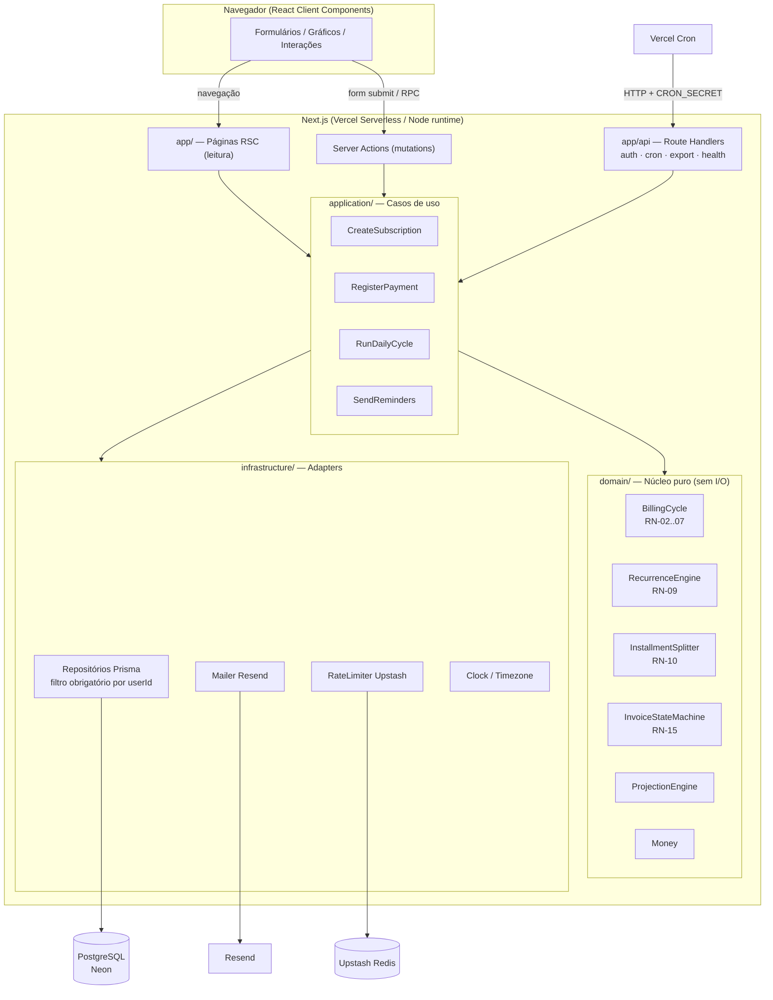
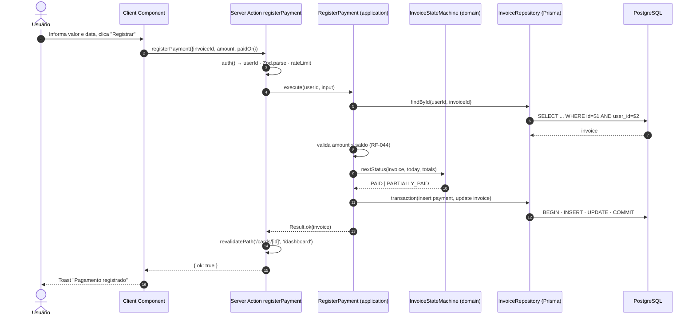
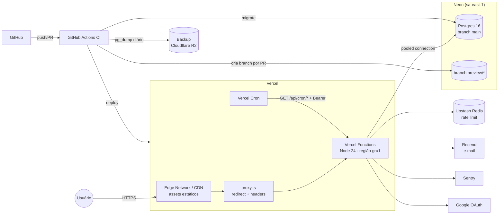
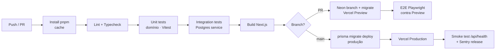

# FinFlow — Arquitetura e Infraestrutura

| Campo | Valor |
|---|---|
| Versão do documento | 1.0 |
| Data | 2026-11-04 |
| Documentos relacionados | [PRD](PRD.md) · [SRS](SRS.md) · [Mapa de Fluxo](FLOW_MAP.md) · [Arquitetura de Software](SOFTWARE_ARCHITECTURE.md) · [Banco de Dados](DATABASE.md) · [API](API_SPEC.md) · [Integrações](INTEGRATIONS.md) |

---

## 1. Direcionadores da arquitetura

| Direcionador | Implicação |
|---|---|
| Equipe pequena (1–2 devs) | Uma linguagem, um deploy, mínimo de serviços para operar |
| Custo baixo no MVP | Serviços gerenciados com free tier generoso, serverless com escala a zero |
| Regras de domínio delicadas (ciclos, parcelas, datas) | Núcleo de domínio puro e testável, isolado do framework |
| Dados financeiros pessoais | Isolamento por usuário, LGPD, nenhum dado real de cartão |
| Evolução futura (PWA, API pública, família) | Camadas bem separadas; poder extrair serviços sem reescrever |

## 2. Decisão: monólito modular full-stack

FinFlow será um **monólito modular** em **Next.js (App Router) + TypeScript**, com backend e frontend no mesmo projeto, organizado em **módulos de domínio** com fronteiras explícitas (cartões, assinaturas, despesas, faturas, notificações, contas).

Alternativas consideradas:

| Opção | Prós | Contras | Veredito |
|---|---|---|---|
| **Next.js full-stack (monólito modular)** | 1 repo, 1 deploy, tipos ponta a ponta, RSC reduz JS no cliente, Server Actions eliminam boilerplate de API | Acoplamento ao ecossistema React/Vercel (mitigado por camadas) | ✅ **Escolhida** |
| SPA (React/Vite) + API separada (NestJS/Fastify) | Separação clara, API pronta para mobile | 2 deploys, 2 pipelines, contratos HTTP para manter, mais custo | ❌ Excesso para o MVP |
| BaaS (Supabase/Firebase) com lógica no cliente | Muito rápido para CRUD | Regras de fatura complexas ficam espalhadas em RLS/edge functions; difícil testar | ❌ |
| Microsserviços | Escala independente | Complexidade operacional injustificável | ❌ |

> Se surgir app mobile nativo (v2+), a camada `application` já expõe casos de uso que podem ser servidos por uma API REST/tRPC em `app/api/v1` sem mudar o domínio.

## 3. Stack tecnológica

| Camada | Tecnologia | Justificativa |
|---|---|---|
| Linguagem | **TypeScript 5 (strict)** | Tipos compartilhados de ponta a ponta |
| Runtime | **Node.js 24 LTS** | LTS ativo, suportado pela Vercel |
| Framework web | **Next.js 16 (App Router)**, React 19 | RSC, Server Actions, Cache Components (`"use cache"`), `proxy.ts`, Turbopack |
| UI | **Tailwind CSS 4** + **shadcn/ui** (Radix) | Componentes acessíveis, customizáveis, sem lock-in |
| Gráficos | **Recharts** | Simples, responsivo, suficiente para rosca/barras/linha |
| Formulários | **React Hook Form** + **Zod** | Mesmo schema valida cliente e servidor |
| Datas | **date-fns** + **date-fns-tz** (ou `Temporal` quando estável) | Aritmética de datas sem horário, fusos |
| Dinheiro | Inteiros em centavos + helper `Money` próprio; `Intl.NumberFormat` para exibição | Sem erros de ponto flutuante |
| ORM | **Prisma 7** (`prisma-client` + driver adapter `@prisma/adapter-pg`; Prisma Migrate) | Schema declarativo, migrações, tipos gerados; cliente sem engine binária; o mesmo driver `pg` atende Neon (endpoint pooled) e Postgres local |
| Banco | **PostgreSQL 16** (Neon) | Relacional, transações, constraints, índices parciais |
| Autenticação | **Better Auth** (adapter Prisma, plugins `magicLink` e `oAuthProxy`) — magic link + Google | Sem senha para gerenciar; sessão em banco; projeto ativo (o Auth.js passou a ser mantido pelo time do Better Auth, em modo manutenção) |
| E-mail | **Resend** + **React Email** | Templates em JSX; free tier 3k/mês e 100/dia |
| Jobs agendados | **Vercel Cron** → Route Handlers idempotentes | Zero infra extra; trocável por qualquer cron HTTP |
| Rate limiting | **Upstash Redis** (`@upstash/ratelimit`) | Serverless, free tier |
| Observabilidade | **Sentry** (erros + performance), **Vercel Analytics**, logs JSON (`pino`) | Visibilidade com custo zero no início |
| Testes | **Vitest** (unit/integração), **Testcontainers** ou Postgres do CI, **Playwright** (E2E) | Cobertura do domínio e dos fluxos críticos |
| Qualidade | ESLint, Prettier, `tsc --noEmit`, Husky + lint-staged | Padronização |
| Pacotes | **pnpm** | Rápido, determinístico |

## 4. Arquitetura lógica (camadas)



### 4.1 Regras de dependência
- `domain/` **não importa nada** de `application/`, `infrastructure/`, Next.js, Prisma ou React. Recebe datas, valores e configurações; devolve resultados. 100% testável com testes unitários puros.
- `application/` orquestra: carrega dados via **interfaces de repositório** (portas), chama o domínio, persiste em transação, dispara efeitos (e-mail).
- `infrastructure/` implementa as portas (Prisma, Resend, Upstash, relógio).
- `app/` (Next.js) é apenas a camada de entrega: autentica, valida entrada (Zod), chama um caso de uso, revalida cache.
- Regra imposta por lint (`eslint-plugin-boundaries` ou `dependency-cruiser`).

### 4.2 Estrutura de diretórios

```
finflow/
├─ docs/                         # PRD, SRS, arquitetura, fluxos, ADRs
├─ prisma/
│  ├─ schema.prisma
│  ├─ migrations/
│  └─ seed.ts                    # categorias padrão, dados de demo
├─ src/
│  ├─ app/                       # Next.js App Router (camada de entrega)
│  │  ├─ (marketing)/            # landing, termos, privacidade
│  │  ├─ (auth)/login/
│  │  ├─ (app)/                  # rotas autenticadas (layout com sidebar)
│  │  │  ├─ dashboard/
│  │  │  ├─ cards/[id]/invoices/[ref]/
│  │  │  ├─ subscriptions/
│  │  │  ├─ expenses/
│  │  │  ├─ calendar/
│  │  │  ├─ notifications/
│  │  │  └─ settings/
│  │  ├─ onboarding/
│  │  └─ api/
│  │     ├─ auth/[...all]/          # Better Auth
│  │     ├─ cron/{daily,reminders,purge}/
│  │     ├─ webhooks/resend/
│  │     ├─ export/  unsubscribe/  health/
│  ├─ modules/                   # um diretório por contexto de domínio
│  │  ├─ cards/
│  │  │  ├─ domain/              # entidades, regras puras
│  │  │  ├─ application/         # casos de uso
│  │  │  ├─ infrastructure/      # repositório Prisma
│  │  │  └─ ui/                  # componentes e server actions do módulo
│  │  ├─ subscriptions/
│  │  ├─ expenses/
│  │  ├─ invoices/               # BillingCycle, InvoiceStateMachine, Projection
│  │  ├─ notifications/
│  │  ├─ categories/
│  │  └─ accounts/               # perfil, LGPD export/delete
│  ├─ shared/
│  │  ├─ domain/                 # Money, DateOnly, Result, erros
│  │  ├─ infrastructure/         # prisma client, logger, mailer, clock, ratelimit
│  │  └─ ui/                     # design system (shadcn), layout, formatadores
│  ├─ emails/                    # templates React Email
│  ├─ lib/auth.ts                # configuração Better Auth (servidor) + auth-client.ts
│  ├─ generated/prisma/          # Prisma Client gerado (não versionado)
│  └─ proxy.ts                   # Next.js 16 (antigo middleware): redirect otimista + headers
├─ tests/
│  ├─ e2e/                       # Playwright
│  └─ fixtures/
├─ docker-compose.yml            # Postgres 16 + Mailpit para dev local
├─ vercel.json                   # crons
└─ .github/workflows/ci.yml
```

## 5. Componentes de domínio críticos

> Implementação de referência, testada, em [SOFTWARE_ARCHITECTURE.md §4.2](SOFTWARE_ARCHITECTURE.md#42-implementação-de-referência-das-regras-de-ciclo).

### 5.1 `BillingCycle` (módulo `invoices/domain`)
Funções puras:
```ts
closingDateFor(year, month, closingDay): DateOnly          // RN-02
dueDateFor(closingDate, closingDay, dueDay): DateOnly       // RN-03
invoiceFor(chargeDate, card, offset = 0): { referenceMonth, periodStart, closingDate, dueDate } // RN-05, RN-06
```

### 5.2 `RecurrenceEngine` (módulo `subscriptions/domain`)
```ts
occurrences(subscription, from: DateOnly, to: DateOnly): DateOnly[]   // RN-09, respeita PAUSED/CANCELED/TRIAL
monthlyEquivalent(amount, cycle): Money                                // RN-12
```

### 5.3 `InstallmentSplitter` (módulo `expenses/domain`)
```ts
splitInstallments(total: bigint, n: number, purchaseDate: DateOnly, card): { number, date, invoice, amountCents }[]  // RN-10
```

### 5.4 `InvoiceStateMachine`
```ts
nextStatus(invoice, today, totals): InvoiceStatus   // RN-15, RN-18
```

### 5.5 `ProjectionEngine`
Combina cobranças materializadas + ocorrências futuras de assinaturas + parcelas já geradas, agrupando por `(card, referenceMonth)` para os próximos 12 meses. Executado sob demanda (sem persistência); custo O(cartões × meses + assinaturas × ocorrências), trivial para os volumes esperados (RNF-03).

### 5.6 Estratégia "materializar o passado, projetar o futuro"
- **Passado/presente (data ≤ hoje):** ocorrências de assinatura viram `charge` persistida pelo job diário → faturas fechadas são imutáveis e auditáveis.
- **Futuro:** calculado em tempo de leitura → mudar valor/cartão/status de uma assinatura reflete instantaneamente nas projeções, sem migrações de dados.
- Parcelas de despesas são persistidas na criação (são compromissos firmes e consomem limite).

## 6. Fluxo de uma mutation (exemplo: registrar pagamento)



## 7. Jobs agendados

| Job | Agenda (UTC) | Responsabilidades | Idempotência |
|---|---|---|---|
| `daily` | `0 3 * * *` (00:00 BRT) | 1) Materializar ocorrências vencidas (RN-11); 2) Converter `TRIAL→ACTIVE`; 3) Fechar faturas (`OPEN→CLOSED`); 4) Marcar `OVERDUE`; 5) Reconciliar `total_cents` (RN-16) | `UNIQUE` em `charge`; transições checam estado atual; processa "tudo pendente até hoje" |
| `reminders` | `0 * * * *` (horário) | Para usuários cujo horário local está na janela 08:00–09:00 (RN-20): calcular lembretes do dia, inserir em `notification` e enviar | `UNIQUE (user, type, entity, target_date, channel)` |
| `purge` | `0 5 * * 0` (semanal) | Remover definitivamente contas com `deleted_at` > 30 dias | Delete por critério |

- Processamento em **lotes de 200 usuários**, com **uma transação por usuário**: o erro ou o timeout de um vira erro registrado (`PARTIAL`) e não desfaz o trabalho dos outros.
- Cursor em `job_runs.cursor` (último usuário concluído, gravado a cada lote): se a execução cai (`FAILED`, inclusive travada), a seguinte começa depois dele e dá a volta até ele; ao terminar, o cursor é limpo.
- Lembretes usam o status da fatura calculado para o dia do usuário (`nextStatus`), não o gravado; o "no dia" da assinatura lê a cobrança já lançada hoje; um lembrete perdido sai até 2 dias depois, com o prazo real no texto (RNF-21).
- Cada execução grava em `job_run` (início, fim, contadores, erro) e reporta ao Sentry (Cron Monitoring).
- Plano Hobby do Vercel limita crons a 1x/dia: no MVP o `reminders` roda junto do `daily` às 11:00 UTC (08:00 BRT); ao migrar para Pro, passa a ser horário (suporte multi-fuso). Alternativa gratuita: GitHub Actions `schedule` chamando o endpoint.

## 8. Infraestrutura

### 8.1 Diagrama de implantação



### 8.2 Provedores e custo estimado

| Serviço | Uso | Plano MVP | Custo MVP | Ao escalar (~1–5k usuários ativos) |
|---|---|---|---|---|
| Vercel | Hosting, funções, cron, CDN | Hobby → Pro | US$ 0 | US$ 20/mês (Pro; necessário para uso comercial) |
| Neon | PostgreSQL serverless, branching | Free (0,5 GB) | US$ 0 | ~US$ 19/mês (Launch) |
| Resend | E-mail transacional | Free (3k/mês, 100/dia) | US$ 0 | US$ 20/mês (50k) — necessário já no beta aberto |
| Upstash Redis | Rate limit | Free | US$ 0 | ~US$ 0–10 |
| Sentry | Erros, performance, cron monitor | Developer | US$ 0 | US$ 26/mês (Team) |
| Cloudflare R2 | Backups lógicos | Free (10 GB) | US$ 0 | ~US$ 0 |
| Domínio | `finflow.app` (ou similar) | — | ~US$ 15/ano | — |
| **Total** | | | **~US$ 0/mês** | **~US$ 60–95/mês** |

> **Região:** Vercel `gru1` (São Paulo) e Neon `aws-sa-east-1` — latência baixa para usuários brasileiros e dados armazenados no Brasil (favorável à LGPD).
>
> Nota: o plano Hobby da Vercel é para uso não comercial. Ao habilitar monetização (plano Pro do FinFlow), migrar para Vercel Pro.

### 8.3 Ambientes

| Ambiente | Gatilho | App | Banco | E-mail |
|---|---|---|---|---|
| Local | `pnpm dev` | localhost:3000 | Postgres via `docker compose` | Mailpit (captura local) |
| Preview | Cada PR | URL de preview Vercel | **Branch Neon efêmero** por PR (copy-on-write) | Resend em modo teste |
| Staging | push em `develop` (opcional) | `staging.finflow.app` | Branch Neon `staging` | Resend (domínio de teste) |
| Produção | merge em `main` | `finflow.app` | Branch Neon `main` | Resend (domínio real) |

### 8.4 Variáveis de ambiente

| Variável | Descrição |
|---|---|
| `DATABASE_URL` | Conexão pooled (PgBouncer do Neon) para a aplicação |
| `DIRECT_URL` | Conexão direta para migrações |
| `BETTER_AUTH_SECRET` | Segredo do Better Auth (assinatura de cookies/tokens) |
| `GOOGLE_CLIENT_ID` / `GOOGLE_CLIENT_SECRET` | OAuth Google |
| `RESEND_API_KEY` / `EMAIL_FROM` | E-mail |
| `RESEND_WEBHOOK_SECRET` | Verificação dos webhooks (Svix) |
| `CRON_SECRET` | Autenticação dos endpoints de cron |
| `UNSUBSCRIBE_SECRET` | Assinatura HMAC dos links de descadastro |
| `UPSTASH_REDIS_REST_URL` / `UPSTASH_REDIS_REST_TOKEN` | Rate limit |
| `SENTRY_DSN` / `SENTRY_AUTH_TOKEN` | Observabilidade |
| `NEXT_PUBLIC_APP_URL` | URL base |

> Inventário completo de segredos, onde ficam e política de rotação: [INTEGRATIONS.md §10](INTEGRATIONS.md#10-inventário-de-segredos).

## 9. CI/CD



- **Proteção da `main`:** PR obrigatório, CI verde, 1 revisão (quando houver mais de 1 dev).
- **Convenção de commits:** Conventional Commits; versionamento semântico com changelog gerado.
- **Migrações:** sempre aditivas (expand → migrate → contract em releases separadas).

## 10. Segurança

| Tema | Medida |
|---|---|
| Autenticação | Better Auth, sessão em banco, cookies `HttpOnly/Secure/SameSite=Lax`, magic link de uso único (15 min) |
| Autorização | Todo repositório recebe `userId` obrigatório na assinatura do método; não existe `findById(id)` sem `userId`. Testes de autorização por action |
| Validação | Zod em toda Server Action e Route Handler; limites de tamanho de strings |
| CSRF | Server Actions validam `Origin`; Route Handlers de cron usam Bearer secret |
| Headers | CSP com nonce, HSTS, `X-Content-Type-Options`, `Referrer-Policy`, `Permissions-Policy` (via `proxy.ts` / `next.config.ts`) |
| Rate limit | Upstash: login, actions, export |
| Segredos | Apenas em env vars da Vercel/GitHub; rotação documentada; `gitleaks` no CI |
| Dependências | Dependabot + `pnpm audit` no CI |
| Dados de cartão | Nenhum dado real (R-01); `last4` validado por constraint no banco |
| LGPD | Dados no Brasil, export JSON, exclusão com purge, política de privacidade, registro de consentimento |

## 11. Escalabilidade e evolução

| Gatilho | Ação |
|---|---|
| > 10k usuários / jobs > 5 min | Migrar jobs para fila (Inngest / QStash) com fan-out por usuário |
| Leituras pesadas no dashboard | Cache por usuário (`unstable_cache` com tag por userId) + índices; materialized view de projeção se necessário |
| App mobile | Expor `app/api/v1` (REST/OpenAPI ou tRPC) sobre os mesmos casos de uso; auth por token |
| Multimoeda (v2) | Tabela `exchange_rate` diária; `Money` já carrega moeda |
| Espaços família (v2) | Introduzir `workspace` como tenant; `user_id` → `workspace_id` + `membership` com papéis (migração expand/contract) |
| Saída da Vercel | Build `output: 'standalone'` em container (Fly.io/Railway/Render) + cron externo; domínio não muda |

## 12. Registro de decisões (ADRs resumidos)

| ADR | Decisão | Status |
|---|---|---|
| ADR-001 | Monólito modular em Next.js full-stack em vez de SPA + API separada | Aceita |
| ADR-002 | PostgreSQL (Neon) em vez de NoSQL — integridade transacional entre fatura, cobranças e pagamentos | Aceita |
| ADR-003 | Dinheiro como inteiro em centavos + moeda | Aceita |
| ADR-004 | Datas de negócio como `DATE` sem hora, interpretadas no fuso do usuário | Aceita |
| ADR-005 | "Materializar passado, projetar futuro" para assinaturas | Aceita |
| ADR-006 | Autenticação sem senha (magic link + Google) via Better Auth | Aceita (revisada: Auth.js → Better Auth) |
| ADR-007 | Jobs via cron HTTP idempotente em vez de worker dedicado no MVP | Aceita (revisar em 10k usuários) |
| ADR-008 | Domínio puro isolado com regra de dependência imposta por lint | Aceita |
| ADR-009 | Nenhum dado real de cartão — fora de escopo PCI-DSS | Aceita |
| ADR-010 | Hospedagem em São Paulo (Vercel gru1 + Neon sa-east-1) | Aceita |

> ADRs completos (contexto, decisão, consequências) devem ser criados em `docs/adr/NNN-titulo.md` à medida que forem revisados.
