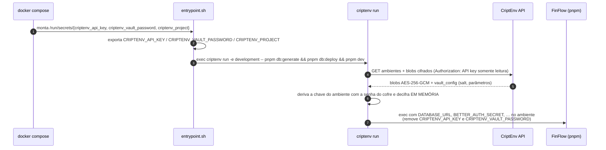

# FinFlow × CriptEnv — secrets de desenvolvimento em container

| Campo | Valor |
|---|---|
| Versão do documento | 1.0 |
| Data | 2026-11-04 |
| CriptEnv CLI | 0.2.3 (PyPI / `ghcr.io/77mdias/criptenv-cli`) |
| Documentos relacionados | [Integrações](INTEGRATIONS.md) · [README](../README.md) |

O [CriptEnv](https://github.com/77mdias/criptenv) é um gerenciador de secrets **zero-knowledge**: os valores são cifrados no cliente (AES-256-GCM, chave derivada da *senha do cofre* do projeto via PBKDF2 + HKDF por ambiente) e o servidor guarda apenas blobs opacos. No FinFlow ele substitui o `.env` no ambiente de desenvolvimento em container: **nenhum secret da aplicação fica em arquivo, na imagem ou no repositório**.

---

## 1. Como funciona



| Peça | Onde | Papel |
|---|---|---|
| `docker/dev/Dockerfile` | imagem `node:24-bookworm-slim` + binário `criptenv` copiado da imagem oficial | Ambiente de desenvolvimento |
| `docker/dev/entrypoint.sh` | `ENTRYPOINT` da imagem | Lê as credenciais (Docker secrets → `*_FILE` → variáveis), valida e executa `criptenv run` |
| `docker-compose.yml` (perfil `app`) | serviço `app` | Monta as credenciais como **Docker secrets** (arquivos em `/run/secrets`, invisíveis no `docker inspect`) |
| `scripts/criptenv-setup.sh` | host | `seed-vault`: cria os secrets de dev no cofre · `credentials`: grava as credenciais em `.criptenv/` |
| `.criptenv/` | host, **ignorado pelo Git**, permissão 600 | Apenas as 3 credenciais de acesso ao cofre |

O que fica **fora** do cofre: só as 3 credenciais de acesso (API key, senha do cofre, ID do projeto) e configurações não sensíveis do compose (`CRIPTENV_ENVIRONMENT`, `CRIPTENV_API_URL`).

---

## 2. Primeira configuração (uma vez)

Pré-requisitos: conta no CriptEnv, CLI no host (`pip install criptenv`), Docker.

```bash
# 1. Login no host e projeto com senha de cofre (o projeto já nasce com development/staging/production)
criptenv login --email                      # pede e-mail e senha
criptenv projects create finflow            # pede a senha do cofre — guarde-a no seu gerenciador de senhas
criptenv projects list                      # anote o ID do projeto

# 2. Gerar e enviar os secrets de desenvolvimento (só cria as chaves que faltam; nunca sobrescreve)
bash scripts/criptenv-setup.sh seed-vault <project-id> development

# 3. API key SOMENTE LEITURA, restrita ao ambiente development, com validade
criptenv api-keys create -p <project-id> -n finflow-docker-dev --env development --expires-days 90

# 4. Gravar as credenciais do container em .criptenv/ (entrada oculta; arquivos 600, fora do Git)
bash scripts/criptenv-setup.sh credentials

# 5. Subir
docker compose --profile app up --build      # http://localhost:3000 · e-mails em http://localhost:8025
```

Secrets criados pelo `seed-vault` (endereços da rede do compose):

| Chave | Valor |
|---|---|
| `DATABASE_URL`, `DIRECT_URL` | `postgresql://finflow:finflow@db:5432/finflow` |
| `BETTER_AUTH_SECRET` | aleatório (32 bytes, base64) |
| `CRON_SECRET`, `UNSUBSCRIBE_SECRET` | aleatórios (24 bytes, hex) |
| `EMAIL_TRANSPORT` / `SMTP_URL` | `smtp` / `smtp://mailpit:1025` |
| `EMAIL_FROM`, `NEXT_PUBLIC_APP_URL` | padrões de desenvolvimento |

> Para rodar o app **no host** (fora do container) com o mesmo cofre: `criptenv run -e <ambiente> -- pnpm dev`, usando um ambiente cujos endereços apontem para `localhost`.

## 3. Operação do dia a dia

| Tarefa | Comando |
|---|---|
| Ver chaves (só nomes) | `criptenv list -p <id> -e development` |
| Alterar um secret | `criptenv set CHAVE=valor -p <id> -e development` e reiniciar: `docker compose --profile app restart app` |
| Comparar um `.env` com o cofre | `criptenv diff .env -p <id> -e development` |
| Revogar o acesso do container | `criptenv api-keys revoke <key-id> -p <id>` — o próximo start falha com 401 |
| Trocar a API key | gerar outra (passo 3) e rodar `bash scripts/criptenv-setup.sh credentials` |
| Usar outro ambiente | `CRIPTENV_ENVIRONMENT=staging docker compose --profile app up` (a API key precisa ter acesso a ele) |
| CriptEnv self-hosted | `CRIPTENV_API_URL=https://sua-api docker compose --profile app up` |
| Fixar a versão da CLI | `CRIPTENV_IMAGE=ghcr.io/77mdias/criptenv-cli:<tag> docker compose --profile app build` |

### Boas práticas aplicadas
- **Menor privilégio:** a API key do container é `read:secrets`, restrita a **um** ambiente e com expiração.
- **Credenciais fora do ambiente do app:** o `criptenv run` remove `CRIPTENV_API_KEY` e `CRIPTENV_VAULT_PASSWORD` do processo da aplicação; as credenciais chegam ao container como Docker secrets (arquivos), não como variáveis visíveis no `docker inspect`.
- **Sem arquivos em claro:** o `seed-vault` usa um arquivo temporário `600` removido ao sair (inclusive em erro).
- **Sinais e exit code:** o `criptenv run` faz `exec` do comando, então `docker stop` chega direto ao Node e o código de saída é propagado.

---

## 4. Relatório do teste do CriptEnv (2026-11-04)

### 4.1 Ambiente do teste
A nuvem do CriptEnv (`criptenv-api.77mdevseven.tech`), o GHCR e o Docker Hub estavam **bloqueados pela política de rede** do ambiente onde o teste foi feito. Por isso o teste foi feito com:
- **API do CriptEnv self-hosted** a partir do código do repositório (`apps/api`, FastAPI + PostgreSQL 16), sem mocks;
- **CLI publicada no PyPI** (`criptenv==0.2.3`);
- o **entrypoint do container executado diretamente no host** (mesmo script, credenciais lidas de arquivos como os Docker secrets), subindo o build de produção do FinFlow.

O `docker build`/`docker compose up` em si **não foi executado** (sem acesso aos registries); o `docker compose config` foi validado.

### 4.2 Resultados

| # | Cenário | Resultado |
|---|---|---|
| 1 | Cadastro, login (`--email`), `projects create` com senha de cofre, ambientes criados automaticamente | ✅ |
| 2 | `push` de 9 secrets para `development`; `list` mostra só nomes; `get` decifra | ✅ |
| 3 | **Zero-knowledge:** dump completo do banco do servidor não contém nenhum valor de secret nem a senha do cofre (apenas ciphertext; nomes das chaves ficam em claro, por design) | ✅ |
| 4 | API key `read:secrets` restrita a um ambiente + `criptenv run` com `HOME` vazio (sem sessão) | ✅ 9 secrets injetados |
| 5 | Credenciais do CriptEnv removidas do processo filho | ✅ |
| 6 | Exit code do processo filho propagado (`exit 7` → 7) | ✅ |
| 7 | Senha do cofre errada | ✅ `Invalid vault password.` |
| 8 | Sem senha e sem TTY | ✅ falha imediata, não trava |
| 9 | Chave restrita a `development` tentando `production` | ✅ bloqueado (ver achado 5) |
| 10 | **FinFlow ponta a ponta** via `entrypoint.sh`: health com banco do cofre, cron aceito só com o `CRON_SECRET` do cofre (401 com outro), login por magic link usando `SMTP_URL` e `BETTER_AUTH_SECRET` do cofre | ✅ |
| 11 | **Rotação:** `set CRON_SECRET` (v6) + restart → novo segredo vale, antigo não | ✅ |
| 12 | **Revogação:** API key revogada → o app não sobe (401) | ✅ (ver achado 1) |
| 13 | `seed-vault` idempotente (2ª execução mantém todas as chaves; `BETTER_AUTH_SECRET` inalterado) | ✅ |

### 4.3 Achados no CriptEnv

| # | Severidade | Componente | Achado | Sugestão |
|---|---|---|---|---|
| 1 | Média | CLI | API key **inválida ou revogada** gera *traceback* Python de ~17 linhas (`CriptEnvAPIError` não tratado) em `run`; a mensagem sugere `criptenv login`, que não se aplica a quem usa API key | Tratar `CriptEnvAPIError` no ponto de entrada da CLI (`click.ClickException`); para 401 com `CRIPTENV_API_KEY`, mensagem do tipo "API key inválida, expirada ou revogada" |
| 2 | Média | API (self-host) | Em banco **vazio**, `alembic upgrade head` falha (`relation "ci_tokens" does not exist`): a 1ª migração pressupõe as tabelas criadas. O `entrypoint.sh` da imagem da API roda exatamente `alembic upgrade head`, então um self-host novo via container falha sem o bootstrap manual (`scripts/init_local_db.py` + `alembic stamp head`) | Adicionar uma migração base (`create_all` → revisão inicial) ou fazer o entrypoint detectar banco vazio e executar o bootstrap + `stamp` |
| 3 | Baixa | CLI | `projects create` lê a senha do cofre direto via `getpass` e **ignora `CRIPTENV_VAULT_PASSWORD`**; sem TTY emite `GetPassWarning` e lê do stdin | Usar o mesmo `prompt_secret`/variável dos demais comandos (ou `--vault-password-stdin`) para permitir automação |
| 4 | Baixa | Docs | README raiz mostra `criptenv login --email you@example.com`, mas `--email` é um *flag*; o e-mail vai em `--email-address` | Corrigir o exemplo |
| 5 | Baixa | CLI/API | Chave restrita a um ambiente pedindo outro recebe `Environment 'production' not found`, não a mensagem específica de restrição que existe no código (a listagem já vem filtrada) | Retornar o escopo da chave junto da lista filtrada para exibir "chave restrita ao ambiente X" |
| 6 | Info | CLI | Mesmo com API key, `run` cria `~/.criptenv/vault.db` (vazio — sem sessão). Exige `HOME` gravável, o que importa em containers com sistema de arquivos somente leitura | Não criar o SQLite quando autenticado só por `CRIPTENV_API_KEY` |
| 7 | Info | API | Cadastro rejeita domínios reservados (ex.: `.local`) — comportamento correto do `email-validator`, apenas registrado | — |

### 4.4 Pendente de validação
- `docker compose --profile app up --build` real (requer acesso a `registry-1.docker.io` e `ghcr.io`).
- Uso contra o **CriptEnv Cloud** (`criptenv-api.77mdevseven.tech`).
