# FinFlow — Mapa de Fluxo

| Campo | Valor |
|---|---|
| Versão do documento | 1.0 |
| Data | 2026-11-04 |
| Documentos relacionados | [PRD](PRD.md) · [SRS](SRS.md) · [Arquitetura](ARCHITECTURE.md) |

> Diagramas em [Mermaid](https://mermaid.js.org/) — renderizam nativamente no GitHub, GitLab, VS Code (extensão) e Obsidian.

## Índice
1. [Mapa do site (navegação)](#1-mapa-do-site-navegação)
2. [Jornada: primeiro acesso e onboarding](#2-jornada-primeiro-acesso-e-onboarding)
3. [Fluxo: autenticação](#3-fluxo-autenticação)
4. [Fluxo: gerenciar cartões](#4-fluxo-gerenciar-cartões)
5. [Fluxo: cadastrar assinatura](#5-fluxo-cadastrar-assinatura)
6. [Fluxo: ciclo de vida da assinatura](#6-fluxo-ciclo-de-vida-da-assinatura)
7. [Fluxo: lançar despesa parcelada](#7-fluxo-lançar-despesa-parcelada)
8. [Fluxo: atribuição de cobrança à fatura](#8-fluxo-atribuição-de-cobrança-à-fatura)
9. [Fluxo: ciclo de vida da fatura](#9-fluxo-ciclo-de-vida-da-fatura)
10. [Fluxo: consultar e pagar fatura](#10-fluxo-consultar-e-pagar-fatura)
11. [Fluxo: job diário](#11-fluxo-job-diário)
12. [Fluxo: lembretes](#12-fluxo-lembretes)
13. [Fluxo: privacidade (exportar / excluir conta)](#13-fluxo-privacidade-exportar--excluir-conta)
14. [Linha do tempo de exemplo](#14-linha-do-tempo-de-exemplo)

---

## 1. Mapa do site (navegação)

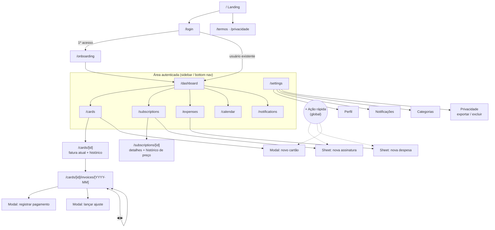

**Navegação principal**
- **Desktop:** sidebar fixa (Dashboard, Cartões, Assinaturas, Despesas, Calendário) + sino de notificações + avatar (Configurações, Sair).
- **Mobile:** bottom nav com 4 itens (Início, Cartões, Assinaturas, Calendário) + botão flutuante **"+"** (nova assinatura / despesa / cartão).

---

## 2. Jornada: primeiro acesso e onboarding

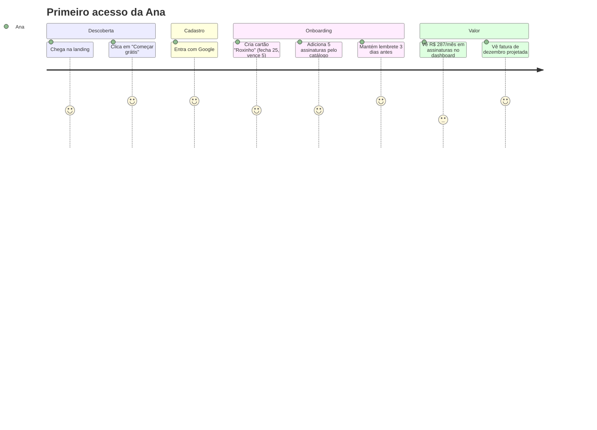

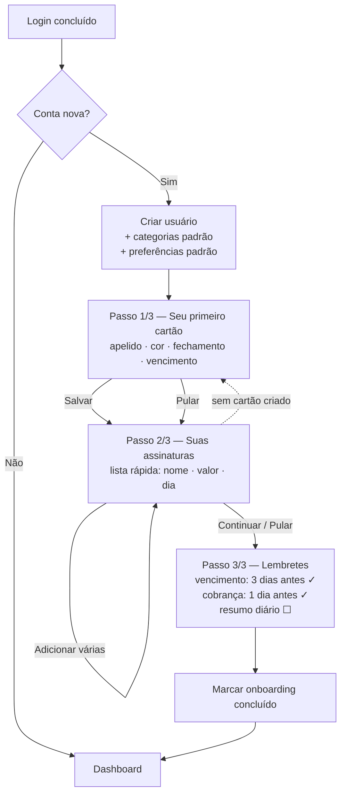

---

## 3. Fluxo: autenticação

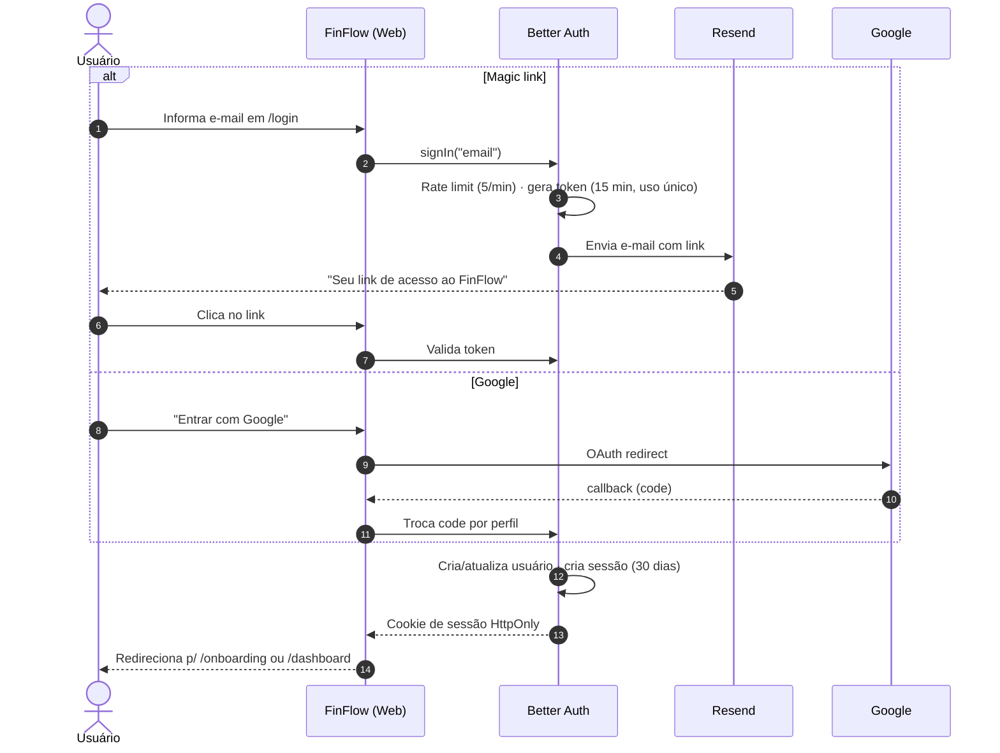

---

## 4. Fluxo: gerenciar cartões

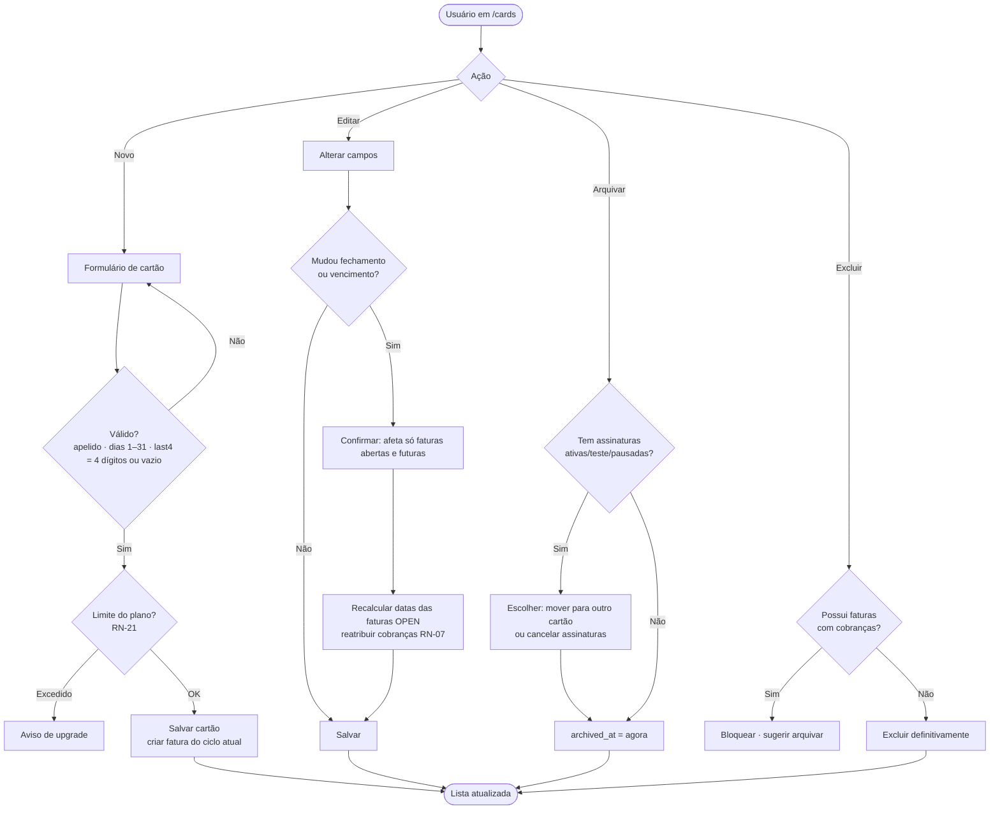

---

## 5. Fluxo: cadastrar assinatura

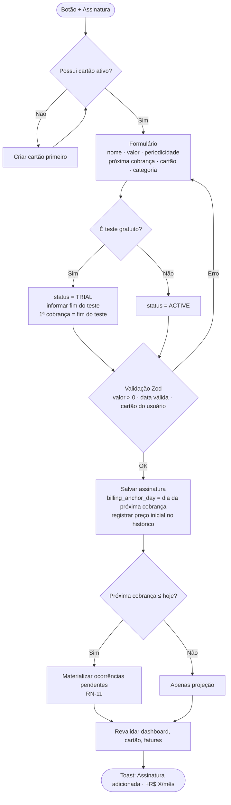

---

## 6. Fluxo: ciclo de vida da assinatura

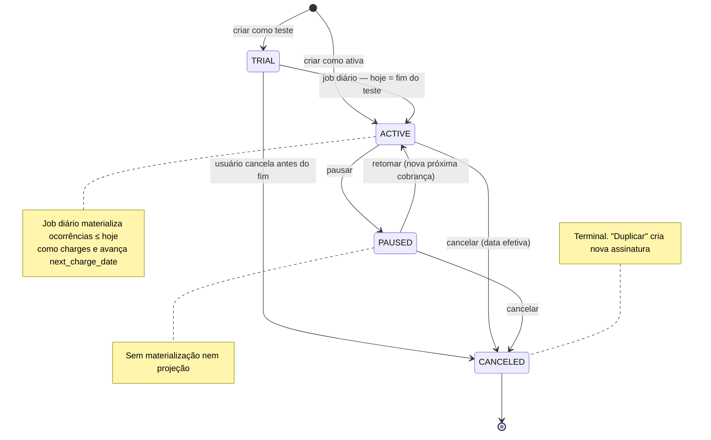

**Alterações em assinatura ativa**

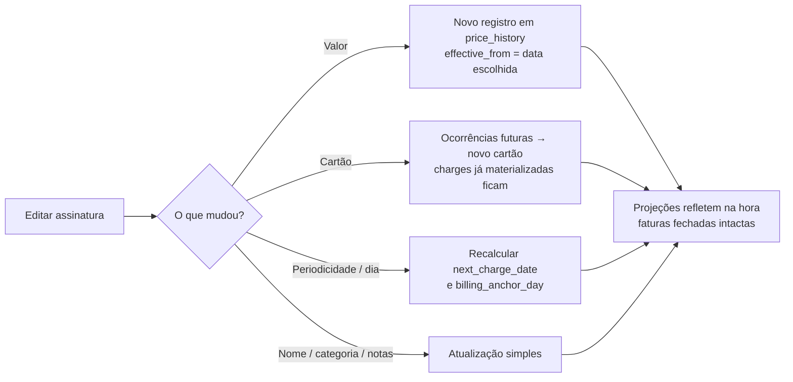

---

## 7. Fluxo: lançar despesa parcelada

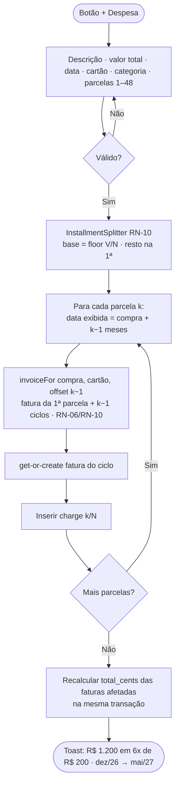

---

## 8. Fluxo: atribuição de cobrança à fatura

Regra central do motor de faturas (RN-02 a RN-06).

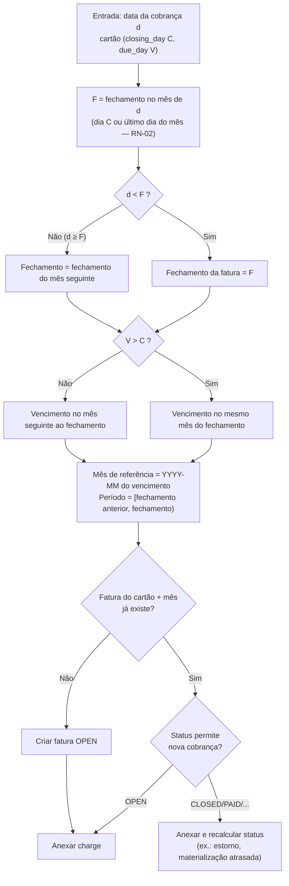

---

## 9. Fluxo: ciclo de vida da fatura

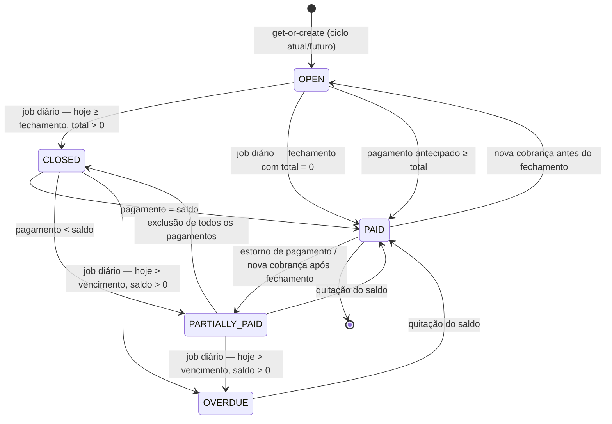

| Status | Cor/ícone na UI | Ações disponíveis |
|---|---|---|
| `OPEN` | Azul · 🕒 "Aberta" | Ver itens, ajuste, pagamento antecipado, ajustar datas |
| `CLOSED` | Âmbar · 📄 "Fechada" | Pagar, ajuste |
| `PARTIALLY_PAID` | Âmbar · ◐ "Parcialmente paga" | Pagar saldo, desfazer pagamento |
| `OVERDUE` | Vermelho · ⚠ "Vencida" | Pagar, ajuste |
| `PAID` | Verde · ✓ "Paga" | Ver comprovante, desfazer pagamento |

---

## 10. Fluxo: consultar e pagar fatura

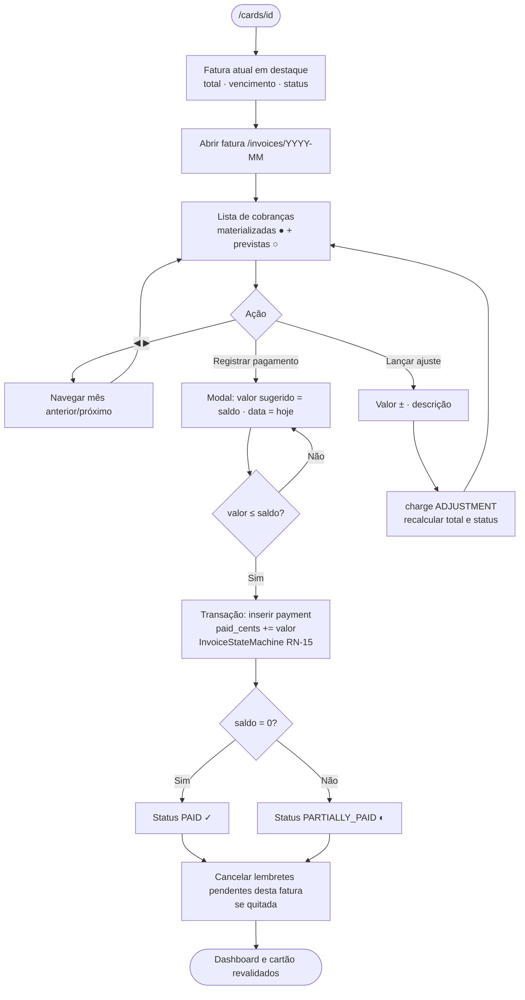

---

## 11. Fluxo: job diário

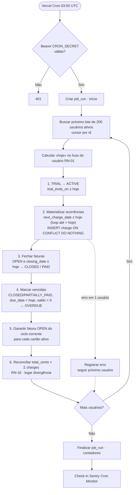

> Cada passo é **idempotente** e processa *tudo pendente até hoje*, então uma execução perdida é recuperada automaticamente na seguinte (RNF-21).

---

## 12. Fluxo: lembretes

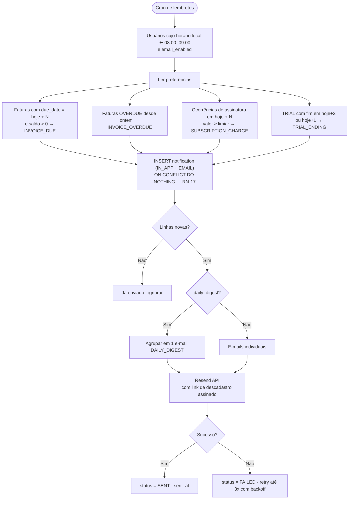

**Exemplo de e-mail (INVOICE_DUE)**
> **Assunto:** Fatura do Roxinho vence em 3 dias — R$ 842,17
> Olá, Ana! A fatura de **dezembro** do cartão **Roxinho** vence em **05/12/2026**.
> Total: **R$ 842,17** · 9 assinaturas · 2 parcelas.
> [Ver fatura] · [Marcar como paga]

---

## 13. Fluxo: privacidade (exportar / excluir conta)

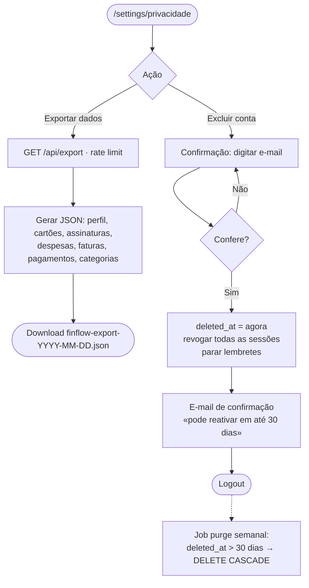

---

## 14. Linha do tempo de exemplo

Cartão **Roxinho** (fecha dia 25, vence dia 5) com Netflix (R$ 55,90, dia 12), Spotify (R$ 21,90, dia 28) e um notebook de R$ 1.200,00 em 6x comprado em 20/11/2026.

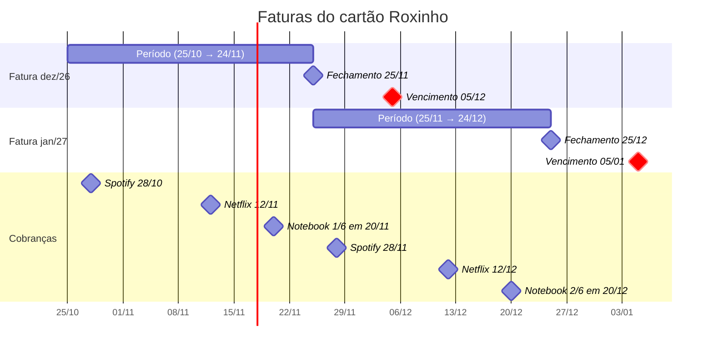

| Fatura | Itens | Total |
|---|---|---|
| **dez/26** (vence 05/12) | Spotify 28/10 (21,90) · Netflix 12/11 (55,90) · Notebook 1/6 (200,00) | **R$ 277,80** |
| **jan/27** (vence 05/01) | Spotify 28/11 (21,90) · Netflix 12/12 (55,90) · Notebook 2/6 (200,00) | **R$ 277,80** |
| fev/27 … mai/27 | Spotify + Netflix + Notebook 3/6 … 6/6 | R$ 277,80 cada |
| jun/27 em diante | Spotify + Netflix | R$ 77,80 |
