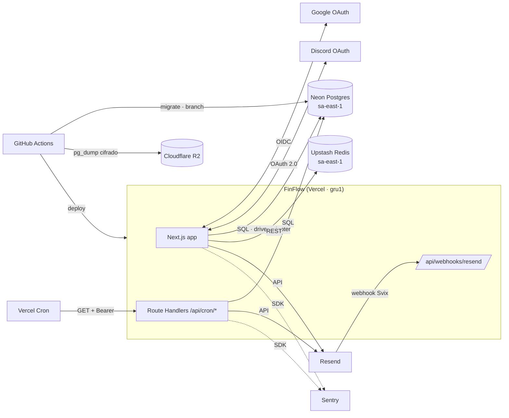
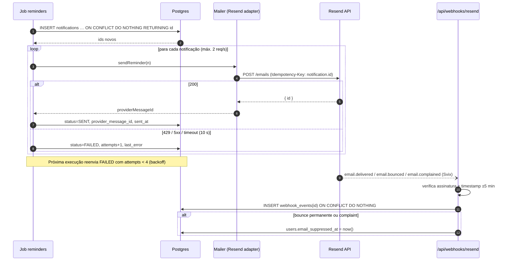
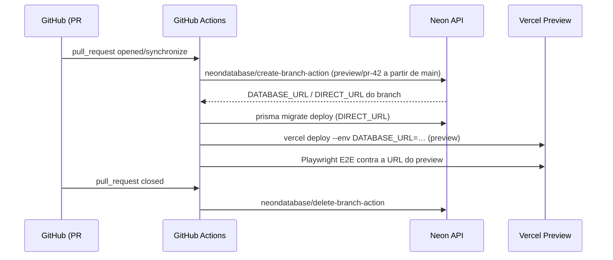
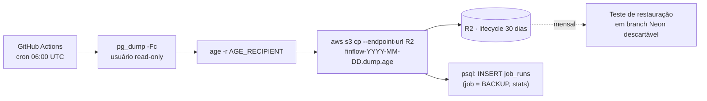

# FinFlow — Integrações Externas

| Campo | Valor |
|---|---|
| Versão do documento | 1.0 |
| Data | 2026-11-04 |
| Documentos relacionados | [Arquitetura & Infraestrutura](ARCHITECTURE.md) · [Arquitetura de Software](SOFTWARE_ARCHITECTURE.md) · [API](API_SPEC.md) · [Banco de Dados](DATABASE.md) |

> Limites e preços de provedores mudam com frequência. Os valores aqui são referência para planejamento; **confirme no painel do provedor antes de cada decisão de plano**.

---

## 1. Mapa de integrações



| # | Integração | Finalidade | Direção | Criticidade | Sem ela… |
|---|---|---|---|---|---|
| 1 | Google OAuth · Discord OAuth | Login social ([§2](#2-google-oauth-via-better-auth), [§2.3](#23-discord-oauth)) | ↔ | Média | Login só por magic link |
| 2 | Resend | Magic links, lembretes, digest | → (+ webhook ←) | **Alta** | Ninguém novo consegue entrar por e-mail; lembretes param |
| 3 | Neon | Banco de dados | → | **Crítica** | App indisponível |
| 4 | Vercel (hosting + Cron) | Execução, CDN, agendamento | — | **Crítica** | App indisponível / jobs parados |
| 5 | Upstash Redis | Rate limiting | → | Baixa | *Fail-open*: app funciona sem limite |
| 6 | Sentry | Erros, performance, cron monitor | → | Baixa | Perda de visibilidade |
| 7 | GitHub Actions | CI/CD, backup | — | Média | Sem deploy/backup automático |
| 8 | Cloudflare R2 | Armazenamento de backups | → | Média | Só PITR do Neon |
| 9 | CriptEnv | Secrets do ambiente de desenvolvimento em container ([CRIPTENV.md](CRIPTENV.md)) | → | Baixa (dev) | Usar `.env` local |

---

## 2. Google OAuth (via Better Auth)

| Item | Valor |
|---|---|
| Protocolo | OAuth 2.0 Authorization Code + PKCE, OpenID Connect |
| Escopos | `openid`, `email`, `profile` (nenhum escopo sensível ⇒ sem auditoria de segurança do Google) |
| Dados recebidos | `sub`, e-mail, e-mail verificado, nome, foto |
| Armazenamento | `accounts` (`provider_id = "google"`, `account_id = sub`); tokens **não** são usados após o login |
| Vinculação de contas | Mesmo e-mail via magic link e Google ⇒ mesma conta (`accountLinking.enabled`, `trustedProviders: ["google"]`) |
| Variáveis | `GOOGLE_CLIENT_ID`, `GOOGLE_CLIENT_SECRET` |

### 2.1 Configuração
1. Google Cloud Console → *APIs & Services* → *OAuth consent screen*: tipo **External**, nome "FinFlow", domínio `finflow.app`, links de política de privacidade e termos.
2. *Credentials* → *OAuth client ID* (Web application). **Authorized redirect URIs**:
   - `https://finflow.app/api/auth/callback/google`
   - `https://staging.finflow.app/api/auth/callback/google`
   - `http://localhost:3000/api/auth/callback/google`
3. **Previews da Vercel** têm URL dinâmica e não podem ser cadastradas no Google. Usar o plugin **`oAuthProxy`** do Better Auth: o callback passa por `staging.finflow.app`, que redireciona de volta à URL do preview com a sessão.

```ts
// src/lib/auth.ts (trecho)
export const auth = betterAuth({
  baseURL: env.NEXT_PUBLIC_APP_URL,
  database: prismaAdapter(prisma, { provider: "postgresql" }),
  socialProviders: {
    google: { clientId: env.GOOGLE_CLIENT_ID, clientSecret: env.GOOGLE_CLIENT_SECRET, prompt: "select_account" },
    discord: { clientId: env.DISCORD_CLIENT_ID, clientSecret: env.DISCORD_CLIENT_SECRET, mapProfileToUser: discordProfileToUser },
  },
  account: { accountLinking: { enabled: true, trustedProviders: ["google"] } },
  session: { expiresIn: 60 * 60 * 24 * 30, updateAge: 60 * 60 * 24, cookieCache: { enabled: true, maxAge: 300 } },
  rateLimit: { enabled: false },                     // política única no Upstash
  plugins: [
    magicLink({ expiresIn: 900, sendMagicLink: ({ email, url }) => mailer.sendMagicLink(email, url) }),
    oAuthProxy({ productionURL: "https://staging.finflow.app" }),
    nextCookies(),
  ],
  databaseHooks: { user: { create: { after: (user) => accounts.onUserCreated(user.id) } } },
});
```

### 2.2 Falhas
| Falha | Comportamento |
|---|---|
| Usuário nega consentimento | Volta a `/entrar?error=access_denied` com mensagem e opção de magic link |
| Google indisponível | Erro amigável; magic link continua disponível |
| E-mail do Google não verificado | Login recusado (só aceitar `email_verified = true`) |

### 2.3 Discord OAuth

| Item | Valor |
|---|---|
| Protocolo | OAuth 2.0 Authorization Code |
| Escopos | `identify`, `email` (padrão do Better Auth; nenhum escopo de bot) |
| Dados recebidos | id, e-mail, `verified`, nome (`global_name` ou `username`), avatar |
| Armazenamento | `accounts` (`provider_id = "discord"`, `account_id = id do Discord`); tokens **não** são usados após o login |
| Vinculação de contas | **Não** é provedor confiável: só vincula a uma conta existente quando o Discord informa o e-mail como verificado |
| E-mail não verificado | `discordProfileToUser` descarta o e-mail ⇒ login recusado com `email_not_found`, sem criar conta (evita pré-sequestro de conta) |
| Variáveis | `DISCORD_CLIENT_ID`, `DISCORD_CLIENT_SECRET` |

**Configuração**
1. [Discord Developer Portal](https://discord.com/developers/applications) → *New Application* "FinFlow". Em *General Information*, preencher os links de termos e política de privacidade.
2. *OAuth2* → copiar o **Client ID**; *Reset Secret* gera o **Client Secret** (aparece uma vez).
3. *OAuth2* → *Redirects*:
   - `https://finflow.app/api/auth/callback/discord`
   - `https://staging.finflow.app/api/auth/callback/discord`
   - `http://localhost:3000/api/auth/callback/discord`
4. Previews da Vercel usam o mesmo `oAuthProxy` do Google (callback por `staging.finflow.app`).

| Falha | Comportamento |
|---|---|
| Usuário cancela no Discord | `/entrar?error=access_denied` |
| E-mail ausente ou não verificado no Discord | `/entrar?error=email_not_found`: pede para confirmar o e-mail no Discord ou entrar pelo link |
| E-mail já tem conta e o Discord não o verificou | `/entrar?error=account_not_linked`: entrar pelo link no e-mail |

---

## 3. Resend (e-mail transacional)

| Item | Valor |
|---|---|
| Uso | Magic link (crítico), lembretes (RF-060..063), resumo diário (RF-066), confirmação de exclusão |
| SDK | `resend` (Node) + templates **React Email** em `src/emails/*` |
| Remetente | `FinFlow <lembretes@mail.finflow.app>` (subdomínio dedicado protege a reputação do domínio raiz) |
| Autenticação de domínio | SPF, DKIM (registros do Resend) e **DMARC** `p=quarantine` em `mail.finflow.app` |
| Variáveis | `RESEND_API_KEY`, `EMAIL_FROM`, `RESEND_WEBHOOK_SECRET` |
| Desenvolvimento local | **Mailpit** (SMTP + UI em `localhost:8025`) — `Mailer` com adapter SMTP quando `EMAIL_TRANSPORT=smtp` |

### 3.1 Contrato interno (porta `Mailer`)

```ts
export interface Mailer {
  sendMagicLink(to: string, url: string): Promise<void>;                 // síncrono, sem fila
  sendReminder(n: ReminderEmail): Promise<{ providerMessageId: string }>;
  sendDigest(d: DigestEmail): Promise<{ providerMessageId: string }>;
}
```

| Template | Assunto (exemplo) | Dados |
|---|---|---|
| `MagicLinkEmail` | "Seu link de acesso ao FinFlow" | `url`, validade |
| `InvoiceDueEmail` | "Fatura do Roxinho vence em 3 dias — R$ 842,17" | cartão, mês, vencimento, total, nº de itens, link |
| `InvoiceOverdueEmail` | "Fatura do Roxinho venceu ontem" | idem + saldo |
| `SubscriptionChargeEmail` | "Netflix será cobrada amanhã — R$ 55,90" | assinatura, valor, cartão, `manageUrl` |
| `TrialEndingEmail` | "Seu teste do ChatGPT Plus acaba em 3 dias" | assinatura, valor após o teste, `manageUrl` |
| `DailyDigestEmail` | "Seu resumo de hoje: 2 vencimentos, 3 cobranças" | lista agregada |
| `AccountDeletionEmail` | "Sua conta será excluída em 30 dias" | data de purge, link para reativar |

Todos os e-mails de lembrete incluem `List-Unsubscribe` + `List-Unsubscribe-Post: List-Unsubscribe=One-Click` ([API_SPEC §8.2](API_SPEC.md#82-token-de-descadastro)). E-mails têm versão texto.

### 3.2 Fluxo de envio e webhooks



| Aspecto | Regra |
|---|---|
| Idempotência no provedor | Header `Idempotency-Key = notification.id` — retentativas não duplicam e-mails |
| Taxa | Respeitar o limite da API (padrão 2 req/s): envio sequencial com *throttle*; resumo diário reduz volume |
| Timeout | 10 s por requisição |
| Retentativas | Até 3 reenvios (execuções seguintes do job), depois `FAILED` definitivo + evento no Sentry |
| Magic link | Envio síncrono na requisição de login; falha ⇒ mensagem "Não foi possível enviar o e-mail, tente novamente" |
| Supressão | `email_suppressed_at` impede novos lembretes; aviso in-app pede para revisar o e-mail. Magic link continua tentando (o usuário pode ter corrigido a caixa) |

### 3.3 Limites e plano
| Plano | Volume | Observação |
|---|---|---|
| Free | 3.000 e-mails/mês **e 100/dia** | O limite **diário** é o gargalo: ~50 usuários ativos com lembretes já o atingem. Suficiente para desenvolvimento e beta fechado |
| Pro | 50.000/mês, sem limite diário | Contratar **antes do beta aberto** (F4 do roadmap) |

---

## 4. Neon (PostgreSQL)

| Item | Valor |
|---|---|
| Projeto | `finflow`, região `aws-sa-east-1`, Postgres 16 |
| Branches | `main` (produção), `staging`, `preview/pr-<n>` (efêmeros, copy-on-write de `main`) |
| Conexão da aplicação | Endpoint **pooled** (`…-pooler…`) via `@prisma/adapter-pg` — o PgBouncer do Neon evita esgotar conexões em serverless |
| Conexão de migração | Endpoint **direto** (`DIRECT_URL`) em `prisma.config.ts` |
| Escala a zero | Compute suspende após inatividade; 1ª query após suspensão tem latência extra (centenas de ms). Aceitável no MVP; desativar *autosuspend* em `main` ao migrar para plano pago |
| Backups | PITR nativo (janela depende do plano) + dump lógico diário (§8) |
| Variáveis | `DATABASE_URL`, `DIRECT_URL`, `NEON_API_KEY` e `NEON_PROJECT_ID` (somente CI) |

### 4.1 Branch por Pull Request



> Branches de preview partem de `main` e, portanto, contêm dados de produção. Até existir anonimização, criar previews a partir de `staging` (dados sintéticos do seed) — **padrão adotado no MVP**.

### 4.2 Falhas
| Falha | Comportamento |
|---|---|
| Neon indisponível | `/api/health` → 503; páginas mostram erro amigável; jobs falham e são recuperados na próxima execução (RNF-21) |
| Timeout de conexão (cold start) | Retentativa única no adapter; timeout de query de 10 s |
| Limite de armazenamento do plano | Alerta do Neon em 80%; purge de retenção (DATABASE §12) |

---

## 5. Vercel (hosting e Cron)

| Item | Valor |
|---|---|
| Framework | Next.js 16, Node.js 24 LTS, Fluid Compute |
| Região das funções | `gru1` (São Paulo) — próxima do Neon `sa-east-1` |
| Skew Protection | Ativada (Server Actions de abas antigas continuam funcionando após deploy) |
| Domínios | `finflow.app` (prod), `staging.finflow.app`, `*.vercel.app` (previews) |
| Variáveis | Por ambiente (Production / Preview / Development) no painel; `vercel env pull` para desenvolvimento |

### 5.1 Cron (`vercel.json`)

```json
{
  "regions": ["gru1"],
  "crons": [
    { "path": "/api/cron/daily",     "schedule": "0 3 * * *" },
    { "path": "/api/cron/reminders", "schedule": "0 11 * * *" },
    { "path": "/api/cron/purge",     "schedule": "0 5 * * 0" }
  ],
  "functions": {
    "src/app/api/cron/**/route.ts": { "maxDuration": 300 }
  }
}
```

| Regra | Detalhe |
|---|---|
| Método | Vercel Cron chama com **GET** e envia `Authorization: Bearer $CRON_SECRET` |
| Autenticação | Handler compara em tempo constante com `CRON_SECRET`; diferente ⇒ 401 |
| Só produção | Crons rodam apenas no deployment de produção |
| Plano Hobby | Cada cron no máximo **1×/dia** e horário com imprecisão de até 1 h ⇒ `reminders` às 11:00 UTC (≈ 08:00 BRT), sem suporte a múltiplos fusos |
| Plano Pro | `reminders` passa a `0 * * * *` (horário), habilitando a janela 08–09 h no fuso de cada usuário (RN-20) |
| Execução manual | `curl -H "Authorization: Bearer $CRON_SECRET" https://finflow.app/api/cron/daily` (idempotente) |
| Alternativa | GitHub Actions `schedule` chamando o mesmo endpoint (fallback se o Cron da Vercel falhar ou para frequência horária no Hobby) |

---

## 6. Upstash Redis (rate limiting)

| Item | Valor |
|---|---|
| Uso | Rate limit de login, Server Actions, export e unsubscribe ([API_SPEC §4](API_SPEC.md#4-rate-limits)) |
| Biblioteca | `@upstash/ratelimit` + `@upstash/redis` (REST, compatível com serverless) |
| Região | `sa-east-1` |
| Algoritmo | Janela deslizante; prefixo `ff:rl:` |
| Dados armazenados | Apenas chaves com hash (`sha256(ip)`, `userId`) e contadores com TTL — sem dados pessoais em claro |
| Variáveis | `UPSTASH_REDIS_REST_URL`, `UPSTASH_REDIS_REST_TOKEN` |
| Desenvolvimento local | Adapter em memória (`RATE_LIMIT_DRIVER=memory`) |

```ts
export const limiters = {
  login:   new Ratelimit({ redis, limiter: Ratelimit.slidingWindow(5, "1 m"),  prefix: "ff:rl:login" }),
  actions: new Ratelimit({ redis, limiter: Ratelimit.slidingWindow(60, "1 m"), prefix: "ff:rl:act" }),
  export:  new Ratelimit({ redis, limiter: Ratelimit.slidingWindow(3, "1 h"),   prefix: "ff:rl:exp" }),
};
```

**Falha:** se o Upstash não responder em 500 ms, a requisição é **permitida** (*fail-open*) e o evento é registrado — indisponibilidade de rate limit não derruba o app.

---

## 7. Sentry (observabilidade)

| Item | Valor |
|---|---|
| SDK | `@sentry/nextjs` (cliente, servidor, edge) via `instrumentation.ts` e `instrumentation-client.ts` |
| Recursos | Erros, tracing (`tracesSampleRate: 0.1`), Cron Monitors, releases com source maps (upload no build) |
| Privacidade | `sendDefaultPii: false`; `beforeSend` remove e-mail, cookies, query strings com `token`, e corpos de requisição; usuário identificado só por `id` |
| Session Replay | **Desligado** (telas contêm valores financeiros) |
| Variáveis | `SENTRY_DSN`, `NEXT_PUBLIC_SENTRY_DSN`, `SENTRY_AUTH_TOKEN` (build), `SENTRY_ORG`, `SENTRY_PROJECT` |

### 7.1 Monitoramento de jobs
```ts
export const GET = withCronAuth(() =>
  Sentry.withMonitor("daily", () => runDailyJob(), {
    schedule: { type: "crontab", value: "0 3 * * *" },
    checkinMargin: 30,          // min: o Hobby tem até 1 h de imprecisão — ajustar para 60
    maxRuntime: 10,             // min
    timezone: "UTC",
  }),
);
```
Alertas: job não executado/falhou → e-mail; taxa de erro > 1% em 5 min → e-mail; novo tipo de erro em produção → e-mail.

---

## 8. Cloudflare R2 (backups)

| Item | Valor |
|---|---|
| Uso | Dump lógico diário do banco de produção (RNF-22) |
| Executor | GitHub Actions (`.github/workflows/backup.yml`), `0 6 * * *` |
| Formato | `pg_dump --format=custom` (cliente na mesma versão major do servidor) |
| Criptografia | Arquivo cifrado com **age** (chave pública no repositório; chave privada fora do GitHub, com o responsável) **antes** do upload |
| Bucket | `finflow-backups` (privado), regra de ciclo de vida: excluir após **30 dias** |
| Acesso | Token R2 com permissão apenas de escrita no bucket |
| Variáveis (secrets do GitHub) | `BACKUP_DATABASE_URL` (usuário somente leitura), `R2_ACCOUNT_ID`, `R2_ACCESS_KEY_ID`, `R2_SECRET_ACCESS_KEY`, `AGE_RECIPIENT` |



**Teste de restauração** mensal (workflow manual): baixar o dump mais recente, decifrar, `pg_restore` em um branch Neon novo, executar a reconciliação (DATABASE Q11) e comparar contagens. Resultado registrado na issue do mês.

---

## 9. GitHub Actions

| Workflow | Gatilho | Passos principais |
|---|---|---|
| `ci.yml` | `pull_request`, `push` em `main` | pnpm install (cache) → lint → typecheck → `dependency-cruiser` → unit → integração (service Postgres 16) → build → `redocly lint docs/api/openapi.yaml` → `gitleaks` |
| `preview.yml` | `pull_request` | Branch Neon (a partir de `staging`) → `prisma migrate deploy` → deploy preview → Playwright + axe |
| `preview-cleanup.yml` | `pull_request: closed` | Excluir branch Neon |
| `deploy.yml` | `push` em `main` | `prisma migrate deploy` (prod, `DIRECT_URL`) → `vercel deploy --prod` → smoke `/api/health` → release Sentry |
| `backup.yml` | `schedule` diário + manual | §8 |
| `restore-test.yml` | manual / mensal | §8 |
| Dependabot | semanal | npm + GitHub Actions |

> Com a integração Git da Vercel, o deploy pode ser feito pela própria Vercel; nesse caso `deploy.yml` executa apenas as migrações e o deploy da Vercel aguarda o check (*Deployment Checks*).

---

## 10. Inventário de segredos

| Variável | Onde | Rotação | Exposição se vazar |
|---|---|---|---|
| `DATABASE_URL`, `DIRECT_URL` | Vercel, GitHub | Semestral ou após incidente | **Crítica** — dados de todos os usuários |
| `BETTER_AUTH_SECRET` | Vercel | Anual (invalida sessões) | Alta — forjar sessões |
| `GOOGLE_CLIENT_SECRET` | Vercel | Anual | Média |
| `DISCORD_CLIENT_SECRET` | Vercel | Anual | Média |
| `RESEND_API_KEY` | Vercel | Anual | Média — envio de e-mail em nome do domínio |
| `RESEND_WEBHOOK_SECRET` | Vercel | Anual | Baixa — eventos falsos de bounce |
| `CRON_SECRET` | Vercel | Anual | Baixa — jobs são idempotentes |
| `UNSUBSCRIBE_SECRET` | Vercel | Só em incidente (invalida links antigos) | Baixa |
| `UPSTASH_REDIS_REST_TOKEN` | Vercel | Anual | Baixa |
| `SENTRY_AUTH_TOKEN` | GitHub/Vercel (build) | Anual | Baixa |
| `NEON_API_KEY` | GitHub | Anual | Alta — gerenciar branches |
| `R2_*`, `BACKUP_DATABASE_URL` | GitHub | Anual | Média (dumps são cifrados) |

Regras: nenhum segredo em código ou `.env` versionado (`.env.example` só com nomes); `gitleaks` no CI; variáveis de Preview **nunca** apontam para produção.

---

## 11. Suboperadores (LGPD)

Lista para a Política de Privacidade (art. 33 — transferência internacional):

| Suboperador | Dados tratados | Localização |
|---|---|---|
| Vercel | Requisições HTTP, logs de função | Funções em São Paulo (gru1); CDN global |
| Neon | Todos os dados da aplicação | AWS São Paulo (sa-east-1) |
| Resend | E-mail, nome, conteúdo dos lembretes (valores, nomes de cartões/assinaturas) | EUA |
| Google | Identidade no login social | Global |
| Discord | Identidade no login social | EUA |
| Upstash | Hash de IP e IDs de usuário (contadores temporários) | AWS São Paulo |
| Sentry | Stack traces, ID do usuário, metadados de requisição (sem PII) | EUA ou UE (escolher região UE se disponível no plano) |
| Cloudflare | Backups cifrados | Conforme jurisdição do bucket |
| GitHub | Código; dumps em trânsito durante o backup | EUA |

---

## 12. Integrações futuras

| Integração | Versão | Finalidade | Observações |
|---|---|---|---|
| Web Push (VAPID) | v1.1 | Lembretes no navegador/PWA | `web-push`; tabela `push_subscriptions`; canal `PUSH` já existe no enum |
| Gateway de pagamento (Stripe, ou Asaas/Mercado Pago para Pix) | v1.1+ | Cobrar o plano Pro | Webhooks idempotentes reutilizando `webhook_events`; `users.plan` atualizado por evento |
| Câmbio (ex.: API do Banco Central — PTAX) | v2 | Assinaturas em USD/EUR + IOF estimado | Job diário grava `exchange_rates` |
| Logos de serviços (catálogo) | v1.1 | Ícones no catálogo | Assets próprios ou de fonte licenciada — não usar marcas sem permissão |
| Calendário (iCal) | v1.1 | Assinar vencimentos no Google/Apple Calendar | `GET /api/calendar/{token}.ics` com token por usuário revogável |
| Open Finance | v2+ (avaliar) | Importar faturas reais | Exige reavaliação de escopo regulatório e de segurança — fora do princípio "sem dados reais" atual |
