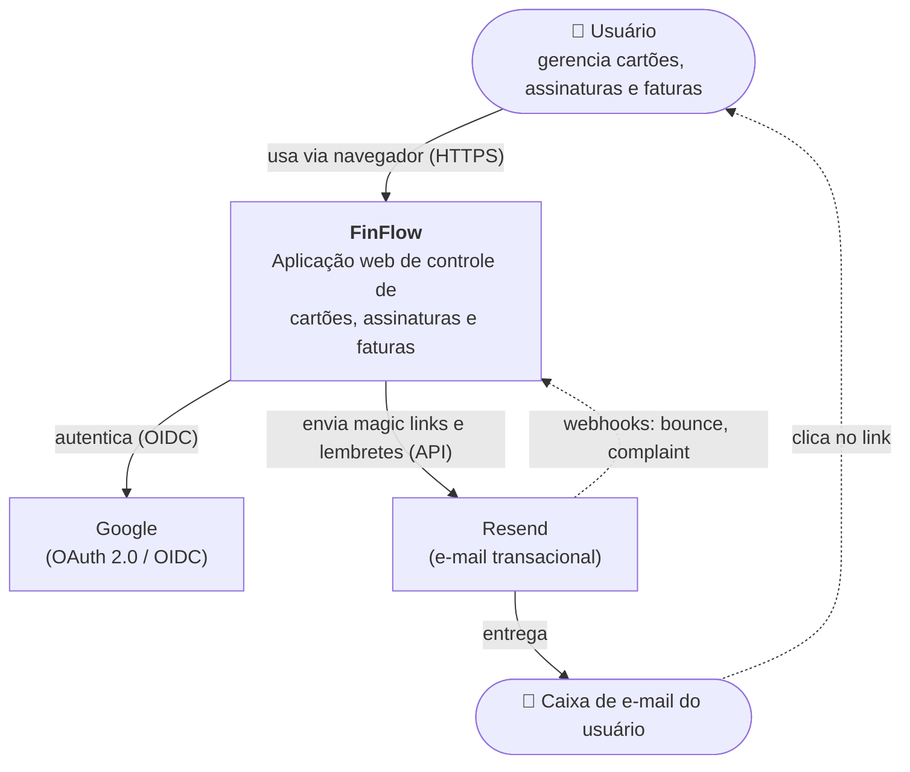
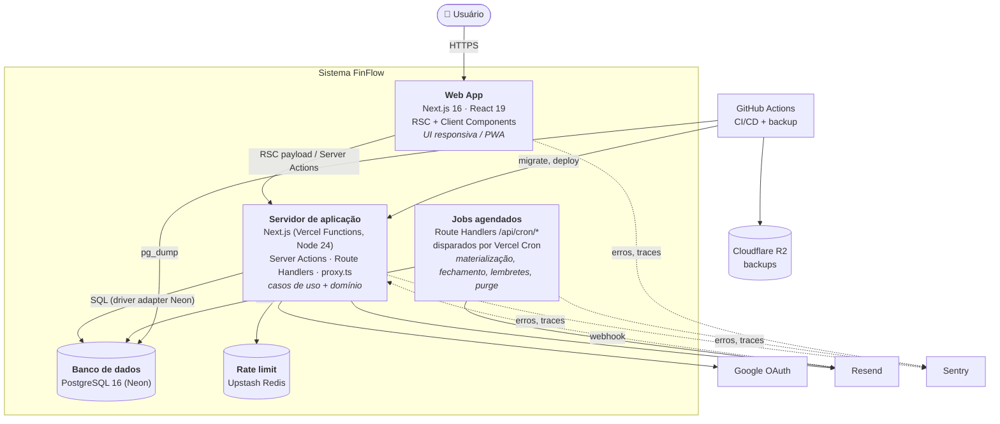
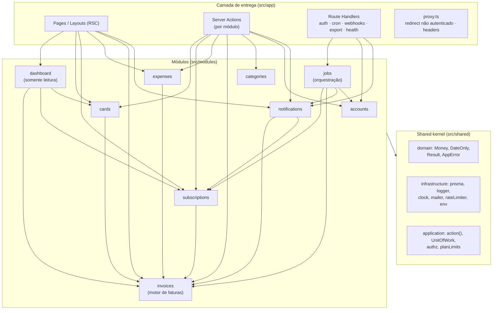
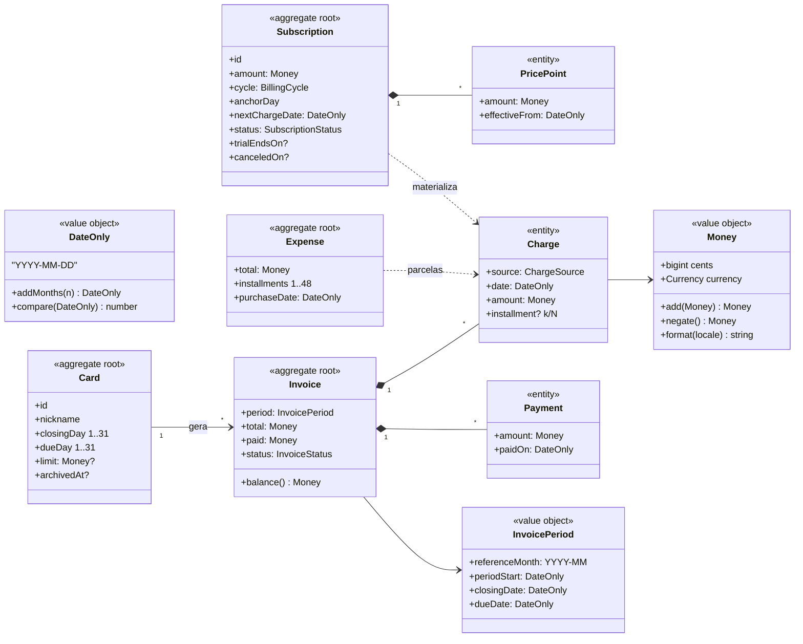
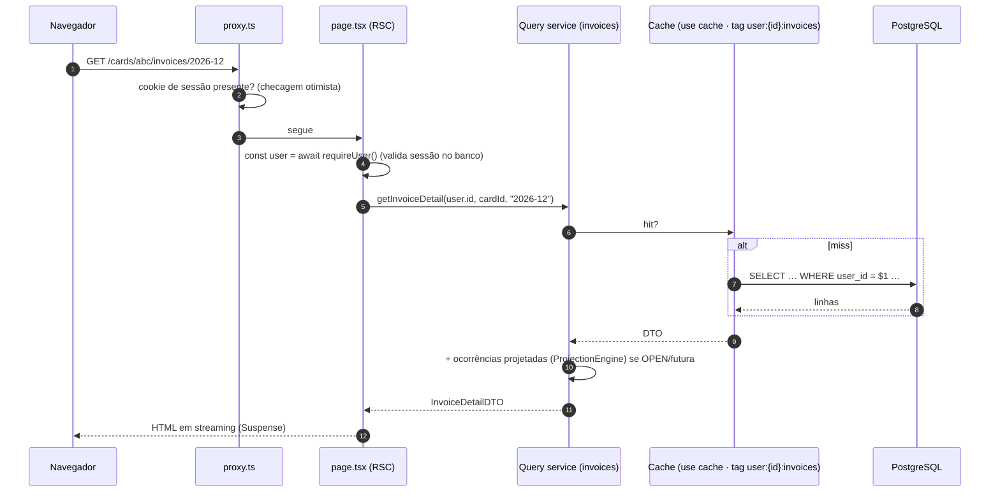
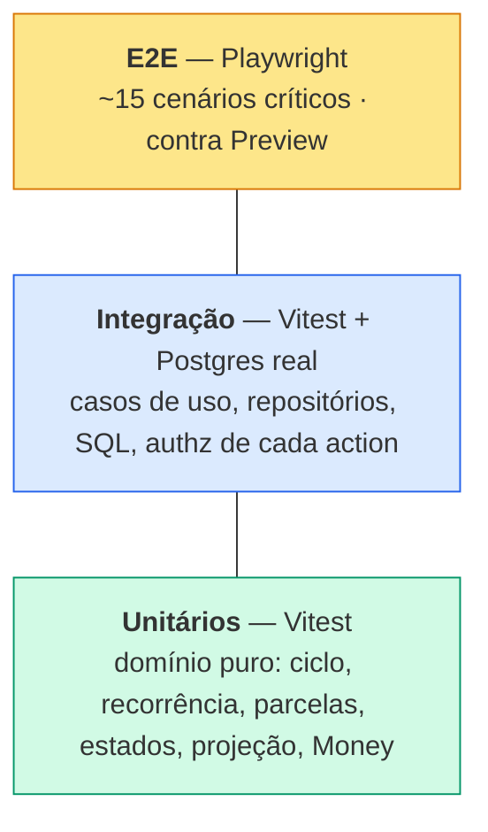

# FinFlow — Documento de Arquitetura de Software

| Campo | Valor |
|---|---|
| Versão do documento | 1.0 |
| Data | 2026-11-04 |
| Escopo | Estrutura interna da aplicação: módulos, camadas, modelo de domínio, preocupações transversais, frontend, testes |
| Documentos relacionados | [Arquitetura & Infraestrutura](ARCHITECTURE.md) · [Banco de Dados](DATABASE.md) · [API](API_SPEC.md) · [Integrações](INTEGRATIONS.md) · [SRS](SRS.md) |

> [ARCHITECTURE.md](ARCHITECTURE.md) responde **"onde e com o quê"** (stack, infraestrutura, deploy, custos, ADRs).
> Este documento responde **"como o código é organizado e por quê"**.

---

## 1. Estilo arquitetural

| Decisão | Descrição |
|---|---|
| **Monólito modular** | Um único deploy Next.js, dividido em módulos de domínio com fronteiras explícitas e API pública por módulo |
| **Hexagonal (Ports & Adapters)** dentro de cada módulo | `domain` (puro) ← `application` (casos de uso + portas) ← `infrastructure` (adapters) ← `ui` (entrega) |
| **CQRS leve** | **Escritas** passam por casos de uso (Server Actions → application → domain → repositório). **Leituras** usam *query services* otimizados (Prisma/SQL direto para DTOs), sem carregar agregados |
| **Domínio funcional** | Regras de negócio como **funções puras** sobre tipos imutáveis; sem classes com estado, sem ORM no domínio |
| **Server-first** | React Server Components por padrão; Client Components apenas para interatividade |

---

## 2. Visão C4

### 2.1 Nível 1 — Contexto



> **Fora do sistema, por design:** bancos, bandeiras, adquirentes, Open Finance. Nenhum dado real de cartão entra no FinFlow (ADR-009).

### 2.2 Nível 2 — Contêineres



> Web App, servidor e jobs são o **mesmo artefato de deploy**; estão separados aqui por responsabilidade em tempo de execução.

### 2.3 Nível 3 — Componentes (servidor de aplicação)



---

## 3. Catálogo de módulos

| Módulo | Responsabilidade | Tabelas que **possui** (escreve) | Depende de |
|---|---|---|---|
| `accounts` | Perfil, preferências gerais, onboarding, consentimentos, exportação e exclusão (LGPD), integração com Better Auth | `users`*, `consents` | `categories`, `notifications` (seed de defaults) |
| `cards` | CRUD de cartões, arquivamento, cartão padrão, uso de limite | `cards` | `invoices` (recalcular datas RN-07), `subscriptions` (mover/cancelar ao arquivar) |
| `categories` | CRUD de categorias, defaults, realocação | `categories` | — |
| `subscriptions` | CRUD, ciclo de vida (RN-13), histórico de preço, recorrência (RN-09), materialização (RN-11), custos equivalentes (RN-12) | `subscriptions`, `subscription_price_history` | `invoices` (lançar cobrança), `categories` |
| `expenses` | Despesas, parcelamento (RN-10) | `expenses` | `invoices` (lançar parcelas) |
| `invoices` | **Motor de faturas**: ciclo (RN-02..07), get-or-create, cobranças, ajustes, pagamentos, máquina de estados (RN-15), projeção, reconciliação | `invoices`, `charges`, `payments` | — (núcleo; não depende de outros módulos) |
| `notifications` | Regras de lembrete, idempotência (RN-17), central in-app, preferências, envio de e-mail, descadastro | `notifications`, `notification_preferences` | `invoices`, `subscriptions` (somente leitura via query services) |
| `dashboard` | Modelos de leitura que combinam módulos: painel, **projeção** (`domain/projection.ts`), fatura com cobranças previstas, próximos eventos | — | `invoices`, `subscriptions`, `cards` |
| `jobs` | Orquestra jobs em lotes, trava por índice único em `job_runs` | `job_runs` | `subscriptions`, `invoices`, `notifications`, `accounts` |

\* `sessions`, `accounts`, `verifications` são escritas exclusivamente pelo Better Auth.

### 3.1 Regras entre módulos
1. Um módulo **só escreve nas tabelas que possui**. `subscriptions` não faz `INSERT INTO charges`; chama `invoices.application.postCharge()`.
2. Um módulo só importa outro pelo **arquivo público** `src/modules/<m>/index.ts` ou pelo seu `domain/` (vocabulário puro compartilhado, ex.: `billing-cycle`). Nunca `application/`, `infrastructure/` ou `ui/` de outro módulo.
3. `invoices` é o **núcleo** e não importa nenhum outro módulo. Ciclos de dependência são proibidos.
4. Leituras entre módulos usam *query services* expostos no `index.ts`.
5. Regras aplicadas por `dependency-cruiser` no CI:

```js
// .dependency-cruiser.cjs (trecho)
forbidden: [
  { name: "domain-is-pure", from: { path: "modules/[^/]+/domain" },
    to: { path: "(application|infrastructure|ui)|node_modules/(next|react|@prisma)" } },
  { name: "no-deep-imports", from: { path: "src/modules/([^/]+)/" },
    to: { path: "src/modules/(?!$1)[^/]+/(?!index\\.ts)" } },
  { name: "invoices-is-core", from: { path: "src/modules/invoices" },
    to: { path: "src/modules/(?!invoices)" } },
  { name: "no-circular", from: {}, to: { circular: true } },
]
```

### 3.2 Estrutura interna de um módulo

```
src/modules/invoices/
├─ index.ts                     # API pública do módulo (única porta de entrada)
├─ domain/
│  ├─ billing-cycle.ts          # invoiceFor, invoiceClosingIn (RN-02..06)
│  ├─ invoice-state.ts          # nextStatus (RN-15, RN-18)
│  ├─ projection.ts             # projectInvoices (soma materializado + previsto)
│  ├─ types.ts                  # Invoice, Charge, Payment, InvoicePeriod (tipos imutáveis)
│  └─ errors.ts                 # PaymentExceedsBalance, InvoiceLocked…
├─ application/
│  ├─ ports.ts                  # InvoiceRepository, ChargeRepository (interfaces)
│  ├─ post-charge.ts            # caso de uso: lançar cobrança
│  ├─ register-payment.ts
│  ├─ close-due-invoices.ts     # usado pelo job diário
│  └─ queries.ts                # getInvoiceDetail, listInvoices (query services)
├─ infrastructure/
│  ├─ prisma-invoice-repository.ts
│  └─ sql/                      # TypedSQL (Q4, Q6, Q7…)
├─ ui/
│  ├─ actions.ts                # "use server" — Server Actions do módulo
│  ├─ schemas.ts                # Zod (compartilhado cliente/servidor)
│  └─ components/               # InvoiceTable, PaymentDialog, StatusBadge…
└─ __tests__/
   ├─ billing-cycle.test.ts
   └─ register-payment.int.test.ts
```

---

## 4. Modelo de domínio

### 4.1 Agregados e objetos de valor



**Invariantes por agregado**

| Agregado | Invariantes (garantidas no domínio **e** por constraint no banco) |
|---|---|
| `Card` | `closingDay, dueDay ∈ [1,31]`; `last4` fictício de 4 dígitos; arquivado não recebe cobrança |
| `Subscription` | `amount > 0`; `TRIAL ⇒ trialEndsOn`; `CANCELED` terminal; transições só pela RN-13 |
| `Expense` | `total > 0`; `1 ≤ installments ≤ 48`; Σ parcelas = total |
| `Invoice` | `total = Σ charges`; `paid = Σ payments ≤ total` (exceto após estorno de cobrança); status coerente com RN-15; cobranças só entram se a data estiver no período (ou for ajuste) |

### 4.2 Implementação de referência das regras de ciclo

Código do módulo `invoices/domain/billing-cycle.ts` (e partes de `subscriptions`/`expenses`). **Testado** contra todos os exemplos do SRS e casos de borda (dia 31, fevereiro, ano bissexto, virada de ano, fechamento 31 + compra dia 30).

```ts
export type DateOnly = string; // "YYYY-MM-DD"
export type BillingCycle = "WEEKLY" | "MONTHLY" | "QUARTERLY" | "SEMIANNUAL" | "YEARLY";

const pad = (n: number) => String(n).padStart(2, "0");
const parts = (d: DateOnly) => d.split("-").map(Number) as [number, number, number];

export const daysInMonth = (y: number, m: number) => new Date(Date.UTC(y, m, 0)).getUTCDate();

/** RN-02: dia inexistente no mês ⇒ último dia do mês. */
export const dateOf = (y: number, m: number, day: number): DateOnly =>
  `${y}-${pad(m)}-${pad(Math.min(day, daysInMonth(y, m)))}`;

export const addMonths = (y: number, m: number, n: number): [number, number] => {
  const t = y * 12 + (m - 1) + n;
  return [Math.floor(t / 12), (t % 12) + 1];
};

export interface CardCycle { closingDay: number; dueDay: number }
export interface InvoicePeriod {
  referenceMonth: string; // YYYY-MM do vencimento (RN-04)
  periodStart: DateOnly;  // inclusivo
  closingDate: DateOnly;  // exclusivo (RN-05)
  dueDate: DateOnly;
}

/** Fatura cujo fechamento ocorre no mês (cy, cm). */
export function invoiceClosingIn(cy: number, cm: number, card: CardCycle): InvoicePeriod {
  const [py, pm] = addMonths(cy, cm, -1);
  const [dy, dm] = card.dueDay > card.closingDay ? [cy, cm] : addMonths(cy, cm, 1); // RN-03
  return {
    referenceMonth: `${dy}-${pad(dm)}`,
    periodStart: dateOf(py, pm, card.closingDay),
    closingDate: dateOf(cy, cm, card.closingDay),
    dueDate: dateOf(dy, dm, card.dueDay),
  };
}

/** RN-03..RN-06: fatura à qual pertence uma cobrança na data `d` (+ `offset` ciclos). */
export function invoiceFor(d: DateOnly, card: CardCycle, offset = 0): InvoicePeriod {
  let [cy, cm] = parts(d);
  if (d >= dateOf(cy, cm, card.closingDay)) [cy, cm] = addMonths(cy, cm, 1); // no/após o fechamento ⇒ próxima
  [cy, cm] = addMonths(cy, cm, offset);
  return invoiceClosingIn(cy, cm, card);
}

const MONTHS: Record<Exclude<BillingCycle, "WEEKLY">, number> =
  { MONTHLY: 1, QUARTERLY: 3, SEMIANNUAL: 6, YEARLY: 12 };

/** RN-09: k-ésima ocorrência a partir da primeira, sempre relativa ao dia âncora. */
export function occurrence(first: DateOnly, anchorDay: number, cycle: BillingCycle, k: number): DateOnly {
  const [y, m, d] = parts(first);
  if (cycle === "WEEKLY") return new Date(Date.UTC(y, m - 1, d + 7 * k)).toISOString().slice(0, 10);
  const [ny, nm] = addMonths(y, m, MONTHS[cycle] * k);
  return dateOf(ny, nm, anchorDay);
}

/**
 * RN-10: divide em N parcelas; o resto vai para a 1ª.
 * A parcela k pertence à fatura da 1ª parcela deslocada k−1 ciclos — nunca pela data
 * recalculada, que poderia pular uma fatura quando o dia é ajustado (RN-02).
 */
export function splitInstallments(totalCents: bigint, n: number, purchase: DateOnly, card: CardCycle) {
  const base = totalCents / BigInt(n);
  const rest = totalCents - base * BigInt(n);
  const [y, m, d] = parts(purchase);
  return Array.from({ length: n }, (_, i) => {
    const [iy, im] = addMonths(y, m, i);
    return {
      number: i + 1,
      date: dateOf(iy, im, d),                 // data exibida da parcela
      invoice: invoiceFor(purchase, card, i),  // fatura de destino
      amountCents: i === 0 ? base + rest : base,
    };
  });
}
```

> **Caso de borda que motivou o `offset`:** cartão com fechamento dia 31, compra de 3x no dia 30/01. Pela data, a 2ª parcela (28/02) cairia **no** fechamento de fevereiro e iria para março, pulando uma fatura. Com o deslocamento de ciclo, as parcelas vão para os fechamentos 31/01, 28/02 e 31/03, como fazem os emissores.

### 4.3 Máquina de estados da fatura (domínio)

```ts
export function nextStatus(inv: { status: InvoiceStatus; closingDate: DateOnly; dueDate: DateOnly;
                                  totalCents: bigint; paidCents: bigint }, today: DateOnly): InvoiceStatus {
  const balance = inv.totalCents - inv.paidCents;
  const closed = today >= inv.closingDate;
  if (!closed) return balance <= 0n && inv.totalCents > 0n ? "PAID" : "OPEN";  // RN-18
  if (balance <= 0n) return "PAID";                                           // inclui fatura zerada
  if (today > inv.dueDate) return "OVERDUE";
  return inv.paidCents > 0n ? "PARTIALLY_PAID" : "CLOSED";
}
```
Função **total** (sempre deriva o status do estado atual), em vez de transições incrementais: torna o job diário, pagamentos e estornos idempotentes por construção.

---

## 5. Camadas e fluxo de requisição

### 5.1 Caminho de leitura (RSC)



### 5.2 Caminho de escrita (Server Action)

Toda Server Action é construída com o *wrapper* `action()`, que padroniza autenticação, validação, rate limit, tratamento de erro, logging e revalidação:

```ts
// src/shared/application/action.ts
export function action<S extends z.ZodType, R>(opts: {
  name: string;
  schema: S;
  rateLimit?: RateLimitPolicy;              // padrão: 60/min por usuário
  handler: (ctx: { user: SessionUser; tx: UnitOfWork; now: Clock }, input: z.infer<S>) => Promise<R>;
  revalidate?: (user: SessionUser, input: z.infer<S>, result: R) => string[]; // tags
}) {
  return async (raw: unknown): Promise<ActionResult<R>> => {
    const requestId = crypto.randomUUID();
    try {
      const user = await requireUser();                        // UNAUTHENTICATED
      await rateLimiter.check(`${opts.name}:${user.id}`, opts.rateLimit); // RATE_LIMITED
      const input = opts.schema.safeParse(raw);
      if (!input.success) return fail("VALIDATION_ERROR", input.error);
      const result = await unitOfWork((tx) => opts.handler({ user, tx, now: clock }, input.data));
      opts.revalidate?.(user, input.data, result).forEach((t) => updateTag(t)); // read-your-writes
      return { ok: true, data: result };
    } catch (e) {
      return toActionError(e, { requestId, action: opts.name });   // AppError → código; resto → INTERNAL + Sentry
    }
  };
}
```

```ts
// src/modules/invoices/ui/actions.ts
"use server";
export const registerPayment = action({
  name: "invoices.registerPayment",
  schema: RegisterPaymentSchema,
  handler: ({ user, tx, now }, input) => registerPaymentUseCase(tx, user.id, input, now.today(user.timezone)),
  revalidate: (user) => [`user:${user.id}:invoices`, `user:${user.id}:dashboard`],
});
```

### 5.3 Unit of Work e repositórios

```ts
// porta (application/ports.ts)
export interface InvoiceRepository {
  findById(userId: UserId, id: InvoiceId, opts?: { forUpdate?: boolean }): Promise<Invoice | null>;
  getOrCreate(userId: UserId, cardId: CardId, period: InvoicePeriod): Promise<Invoice>;
  addPayment(userId: UserId, invoiceId: InvoiceId, p: NewPayment, status: InvoiceStatus): Promise<Payment>;
  // …
}

// unit of work: um PrismaClient transacional entregue aos repositórios
export async function unitOfWork<T>(fn: (tx: UnitOfWork) => Promise<T>): Promise<T> {
  return prisma.$transaction((client) => fn(makeRepositories(client)), { timeout: 10_000 });
}
```

> **Implementação atual (MVP):** os casos de uso recebem o cliente transacional tipado do Prisma (`Tx`) e o usam diretamente — o Prisma Client funciona como a "porta" de persistência, e SQL bruto (`$queryRaw`) fica restrito a consultas específicas (limite usado, `FOR UPDATE` em pagamentos, reconciliação). Interfaces de repositório explícitas serão extraídas quando surgir um segundo adapter. O isolamento por `userId` continua obrigatório em toda consulta.

**Regra de ouro de autorização:** toda assinatura de método de repositório recebe `userId` como **primeiro parâmetro obrigatório** e todo `WHERE` inclui `user_id`. Não existe `findById(id)`. Um recurso de outro usuário é indistinguível de um inexistente ⇒ `NOT_FOUND` (não vaza existência).

---

## 6. Preocupações transversais

### 6.1 Autenticação e sessão
| Item | Decisão |
|---|---|
| Biblioteca | **Better Auth** (plugins `magicLink`, provider social Google, adapter Prisma) |
| Sessão | Em banco (`sessions`), cookie `HttpOnly; Secure; SameSite=Lax`, expiração 30 dias deslizante (`updateAge` 1 dia) |
| Cookie cache | Habilitado (5 min) para reduzir leituras de sessão |
| `proxy.ts` | Checagem **otimista** (existência do cookie) para redirecionar a `/login`; **não** é a barreira de segurança |
| Barreira real | `requireUser()` em toda page/layout autenticado, Server Action e Route Handler (valida sessão no banco/cache) |
| Hooks | `databaseHooks.user.create.after` → `accounts.onUserCreated()` (preferências padrão, categorias, consentimento) |

### 6.2 Validação
- Schemas **Zod** em `ui/schemas.ts` de cada módulo, usados pelo formulário (React Hook Form) e pela Server Action.
- Dinheiro trafega como **string decimal** no formulário (`"55,90"`) e é convertido para centavos no schema (`moneyInput()`), nunca via `parseFloat`.
- Datas trafegam como `"YYYY-MM-DD"` (`dateOnlyInput()`).

### 6.3 Erros

`AppError` com código estável (contrato da API — lista completa em [API_SPEC §3](API_SPEC.md#3-modelo-de-erros)):

```ts
export class AppError extends Error {
  constructor(public code: ErrorCode, message: string, public details?: Record<string, unknown>) { super(message); }
}
// domínio retorna Result para falhas esperadas; application converte para AppError
export type Result<T, E = DomainError> = { ok: true; value: T } | { ok: false; error: E };
```

| Tipo | Onde nasce | Tratamento |
|---|---|---|
| Erro de domínio esperado (`PAYMENT_EXCEEDS_BALANCE`) | `domain` → `Result` | Mensagem amigável ao usuário, sem Sentry |
| Erro de validação | Zod | `fieldErrors` exibidos nos campos |
| Recurso não encontrado / de outro usuário | repositório | `NOT_FOUND` |
| Conflito de concorrência | repositório (`updatedAt` divergente) | `CONFLICT` → "Atualize a página" |
| Inesperado | qualquer | `INTERNAL` + Sentry com `requestId`; mensagem genérica |

### 6.4 Cache e revalidação (Next.js 16 Cache Components)

| Dado | Estratégia | Tag |
|---|---|---|
| Dados do usuário (cartões, faturas, assinaturas) | `"use cache"` em query services, `cacheLife("minutes")` | `user:{id}:cards`, `user:{id}:invoices`, `user:{id}:subscriptions`, `user:{id}:dashboard` |
| Catálogo de serviços (v1.1) | `"use cache"`, `cacheLife("days")` | `catalog` |
| Após mutation (Server Action) | `updateTag(tag)` das tags afetadas, no wrapper `action()` — expira e recarrega na mesma requisição (o usuário vê a própria escrita) | — |
| Após job diário (Route Handler) | `revalidateTag(tag, "max")` para `user:{id}:*` dos usuários com mudanças (stale-while-revalidate) | — |

**Mapa de invalidação**

| Mutation | Tags revalidadas |
|---|---|
| cards.* | `cards`, `invoices`, `dashboard` |
| subscriptions.* | `subscriptions`, `invoices`, `dashboard` |
| expenses.* | `invoices`, `dashboard` |
| invoices.* (pagamento, ajuste, datas) | `invoices`, `cards`, `dashboard` |
| categories.* | `subscriptions`, `invoices`, `dashboard` |
| notifications.markRead | `notifications` |

### 6.5 Tempo e fuso horário
- Interface `Clock { now(): Date; today(tz: string): DateOnly }` injetada nos casos de uso; testes usam `FixedClock`.
- "Hoje" sempre derivado do fuso do usuário (`Intl.DateTimeFormat` com `timeZone`), nunca de `new Date()` no servidor (que roda em UTC).

### 6.6 Dinheiro
- `Money` = `{ cents: bigint; currency: "BRL" }`; operações só entre mesma moeda.
- Formatação apenas na borda (`Intl.NumberFormat("pt-BR", { style: "currency", currency })`).
- DTOs para o cliente: `amountCents: number` (+ `currency`), seguro até 2⁵³.

### 6.7 Configuração
- `src/shared/config/env.ts` valida todas as variáveis com Zod no boot (falha rápido). Variáveis públicas apenas com prefixo `NEXT_PUBLIC_`.

### 6.8 Logging e observabilidade
- `pino` com saída JSON; campos padrão: `requestId`, `userId` (hash), `action`, `durationMs`, `jobRunId`.
- **Proibido** logar: e-mail completo, tokens, cookies, valores financeiros junto com identificador do usuário (RNF-16) — `pino.redact` configurado.
- Sentry: erros + tracing (amostragem 10%) + Cron Monitors para os jobs.

### 6.9 Limites de plano (feature flags)
```ts
export const PLAN_LIMITS = { FREE: { cards: 3, subscriptions: 15 }, PRO: { cards: Infinity, subscriptions: Infinity } };
assertWithinPlan(user, "cards", currentCount); // lança PLAN_LIMIT_REACHED se LIMITS_ENFORCED=true
```

### 6.10 Internacionalização
- `next-intl` com mensagens em `messages/pt-BR.json`; pt-BR no MVP, estrutura para en-US (v1.1).
- Datas e moedas sempre por `Intl` com o `locale` do usuário.

---

## 7. Arquitetura do frontend

| Tema | Decisão |
|---|---|
| Renderização | RSC por padrão; `"use client"` apenas em formulários, gráficos, diálogos, drag & drop |
| Estado de servidor | Vem do RSC (sem React Query no MVP); após mutation, revalidação por tag |
| Estado de UI | Local (`useState`) ou **na URL** (`searchParams`: filtros, mês da fatura, aba) — compartilhável e sobrevive a refresh |
| Formulários | React Hook Form + `zodResolver` + Server Action; `useActionState` para pendência/erros |
| UI otimista | `useOptimistic` em: marcar notificação lida, pausar/retomar assinatura, registrar pagamento |
| Streaming | `loading.tsx` + `<Suspense>` por bloco do dashboard (cada card carrega independente) |
| Design system | shadcn/ui (Radix) + tokens Tailwind; componentes de domínio em `modules/*/ui/components` |
| Componentes-chave | `CardVisual`, `MoneyInput`, `DateOnlyPicker`, `InvoiceStatusBadge`, `ChargeRow` (materializado ● / previsto ○), `ProjectionChart`, `CategoryDonut`, `UpcomingList` |
| Acessibilidade | Radix (foco, teclado, ARIA), `aria-live` para toasts, status com ícone + texto, contraste AA verificado no CI (axe + Playwright) |
| PWA (v1.1) | Manifest + service worker (somente cache de assets; dados sempre online) |

### 7.1 Árvore de layouts

```
app/
├─ layout.tsx                    # <html>, fontes, ThemeProvider, Toaster, Sentry
├─ (marketing)/layout.tsx        # header público
├─ (auth)/login/page.tsx
├─ onboarding/layout.tsx         # requireUser(); wizard sem sidebar
└─ (app)/layout.tsx              # requireUser(); redireciona p/ onboarding se não concluído
   ├─ AppShell: Sidebar (desktop) · BottomNav + FAB (mobile) · NotificationBell
   └─ dashboard/ cards/ subscriptions/ expenses/ calendar/ notifications/ settings/
```

---

## 8. Estratégia de testes



| Nível | Escopo | Ferramentas | Meta |
|---|---|---|---|
| Unitário | `modules/*/domain`, `shared/domain` | Vitest; **testes baseados em propriedades** (`fast-check`) para ciclo/parcelas: "Σ parcelas = total", "parcelas em faturas consecutivas", "cobrança sempre dentro de `[periodStart, closingDate)`" | ≥ 90% de cobertura |
| Integração | Casos de uso + Prisma + SQL; jobs | Vitest + Postgres 16 (service do CI / Testcontainers), `FixedClock`, transação revertida por teste | Todos os casos de uso |
| Autorização | Cada Server Action e Route Handler | Teste gerado por tabela: usuário B tenta agir sobre recurso de A ⇒ `NOT_FOUND` | 100% das actions |
| E2E | Login (magic link via Mailpit), onboarding, criar cartão/assinatura/despesa, ver fatura, pagar, lembrete | Playwright + axe | Fluxos do PRD §13 |
| Contrato | `openapi.yaml` × Route Handlers | `@redocly/cli lint` + testes de resposta com schema | Rotas HTTP |

**Dados de teste:** *builders* (`aCard().closingOn(25).dueOn(5).build()`), fixtures do exemplo do [FLOW_MAP §14](FLOW_MAP.md#14-linha-do-tempo-de-exemplo) como teste de aceitação "dourado".

---

## 9. Convenções de código

| Tema | Convenção |
|---|---|
| Linguagem | TypeScript `strict`, `noUncheckedIndexedAccess`, ESM |
| Nomes de arquivo | `kebab-case.ts`; componentes React `PascalCase.tsx` |
| Casos de uso | verbo + substantivo: `register-payment.ts` exporta `registerPayment()` |
| IDs | *branded types*: `type CardId = string & { __brand: "CardId" }` |
| Imports | alias `@/` → `src/`; ordem automática (eslint-plugin-simple-import-sort) |
| Commits | Conventional Commits (`feat(invoices): …`) |
| Comentários | Referenciar a regra: `// RN-06` |
| Proibido | `float` para dinheiro; `new Date("YYYY-MM-DD")` sem utilitário `DateOnly`; `any`; acesso a Prisma fora de `infrastructure` |

---

## 10. Atributos de qualidade → táticas

| Atributo (SRS) | Táticas arquiteturais |
|---|---|
| Correção financeira | Domínio puro testado por propriedades; centavos inteiros; constraints no banco espelhando invariantes; reconciliação diária de caches |
| Segurança / isolamento (RNF-11) | `userId` obrigatório em repositórios; teste de authz por action; `NOT_FOUND` para recurso alheio |
| Idempotência (RNF-21) | Chaves únicas naturais (`ON CONFLICT DO NOTHING`); status derivado por função total; trava de jobs por índice único parcial |
| Desempenho (RNF-01..03) | RSC + streaming; cache por usuário com tags; índices parciais; projeção em memória O(n) |
| Manutenibilidade (RNF-40..43) | Módulos com API pública, regras de dependência no CI, ADRs |
| Portabilidade (RNF-61) | Domínio e aplicação sem dependência de Vercel; jobs são HTTP; Prisma com driver adapter trocável |
| Observabilidade (RNF-50..53) | `requestId`/`jobRunId` em logs; Sentry; `job_runs` |

---

## 11. Evolução prevista

| Mudança | Impacto na arquitetura |
|---|---|
| API pública / app mobile | Novo adapter de entrega `app/api/v1/*` chamando os **mesmos casos de uso** (ver [API_SPEC §10](API_SPEC.md#10-api-rest-v1-planejada)) |
| Espaços família (v2) | `workspaceId` substitui `userId` como chave de tenant nos repositórios; a regra "primeiro parâmetro obrigatório" torna a migração mecânica |
| Multimoeda (v2) | `Money` já carrega moeda; novo serviço `fx` no shared kernel |
| Volume de jobs | `jobs` passa a publicar 1 mensagem por usuário numa fila (QStash/Inngest); casos de uso não mudam |
| Domínio de eventos | Introduzir eventos de domínio in-process (`PaymentRegistered`, `ChargePosted`) quando houver ≥ 2 consumidores do mesmo fato |
