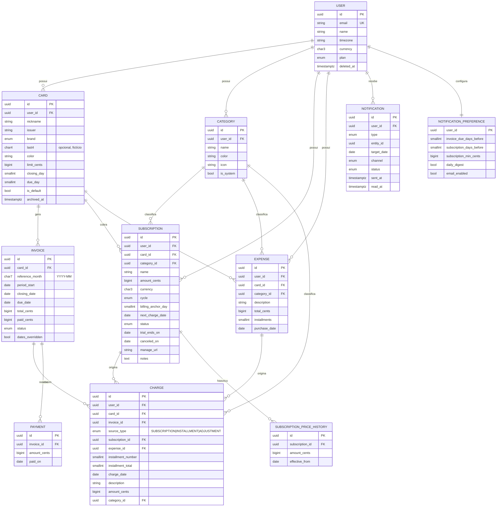

# FinFlow — Software Requirements Specification (SRS)

| Campo | Valor |
|---|---|
| Produto | FinFlow |
| Versão do documento | 1.0 |
| Data | 2026-11-04 |
| Padrão de referência | Estrutura inspirada na ISO/IEC/IEEE 29148 |
| Documentos relacionados | [PRD](PRD.md) · [Arquitetura](ARCHITECTURE.md) · [Mapa de Fluxo](FLOW_MAP.md) |

---

## 1. Introdução

### 1.1 Propósito
Este documento especifica os requisitos de software do FinFlow v1.0 (MVP): comportamento funcional, regras de negócio, modelo de dados, interfaces e atributos de qualidade. É a referência para implementação, testes e aceite.

### 1.2 Escopo
O FinFlow é uma aplicação web multiusuário em que cada usuário gerencia **cartões virtuais** (representações sem dados reais), **assinaturas recorrentes**, **despesas avulsas/parceladas** e as **faturas** resultantes, com **lembretes** de cobrança e vencimento.

### 1.3 Definições e acrônimos

| Termo | Definição |
|---|---|
| **Cartão virtual** | Registro criado pelo usuário que modela um cartão de crédito: apelido, limite, dia de fechamento e dia de vencimento. Não contém dados reais. |
| **Dia de fechamento** | Dia do mês em que o ciclo da fatura se encerra. |
| **Dia de vencimento** | Dia do mês em que a fatura deve ser paga. |
| **Ciclo / período** | Intervalo de datas cujas cobranças compõem uma fatura. |
| **Mês de referência** | Mês/ano (`YYYY-MM`) do **vencimento** da fatura. Ex.: "fatura de dezembro" vence em dezembro. |
| **Assinatura** | Cobrança recorrente com valor e periodicidade fixos. |
| **Despesa** | Compra manual, à vista ou parcelada. |
| **Cobrança (charge)** | Lançamento individual que compõe uma fatura (ocorrência de assinatura, parcela de despesa ou ajuste). |
| **Materialização** | Ato de persistir uma ocorrência de assinatura como cobrança, quando sua data chega. |
| **Projeção** | Cálculo de cobranças/faturas futuras ainda não materializadas. |
| **RN** | Regra de negócio. **RF** requisito funcional. **RNF** requisito não funcional. |
| **LGPD** | Lei Geral de Proteção de Dados (Lei 13.709/2018). |

### 1.4 Visão geral do documento
Seção 2 descreve o contexto; seção 3 lista requisitos funcionais; seção 4 as regras de negócio; seção 5 o modelo de dados; seção 6 interfaces; seção 7 requisitos não funcionais; seção 8 critérios de aceite e rastreabilidade.

---

## 2. Descrição geral

### 2.1 Perspectiva do produto
Aplicação web standalone (monólito modular Next.js) com banco PostgreSQL gerenciado, jobs agendados e serviço de e-mail transacional. Sem integração com instituições financeiras. Detalhes em [ARCHITECTURE.md](ARCHITECTURE.md).

### 2.2 Classes de usuários

| Classe | Descrição | Permissões |
|---|---|---|
| Visitante | Não autenticado | Landing page, login, termos, privacidade |
| Usuário | Autenticado | CRUD sobre os próprios dados apenas |
| Sistema (jobs) | Processos agendados | Materializar cobranças, fechar faturas, enviar lembretes |
| Administrador (v1.1) | Equipe FinFlow | Métricas agregadas, suporte; **sem** acesso a dados financeiros individuais em texto livre |

### 2.3 Ambiente operacional
- Navegadores: duas últimas versões de Chrome, Edge, Firefox, Safari (desktop e mobile).
- Telas de 360 px de largura em diante.
- Servidor: runtime Node.js 24 LTS (serverless).

### 2.4 Restrições de design e implementação
- **R-01:** O sistema não deve coletar PAN, CVV, validade real ou credenciais bancárias.
- **R-02:** Valores monetários são armazenados como **inteiros em centavos** (`BIGINT`) + código de moeda ISO 4217. Proibido `float` para dinheiro.
- **R-03:** Datas de negócio (cobrança, fechamento, vencimento) são armazenadas como `DATE` (sem hora) e interpretadas no fuso do usuário. Timestamps técnicos em `TIMESTAMPTZ` UTC.
- **R-04:** Todo acesso a dados é filtrado por `user_id` na camada de repositório (isolamento multi-tenant).
- **R-05:** Interface em pt-BR, com strings externalizadas para i18n.

### 2.5 Premissas e dependências
- Usuário possui e-mail válido.
- Serviços externos: Neon (Postgres), Vercel (hosting/cron), Resend (e-mail), Google OAuth, Upstash (rate limit), Sentry, Cloudflare R2 (backups). Detalhes em [INTEGRATIONS.md](INTEGRATIONS.md).
- MVP opera em moeda única por usuário (BRL padrão); campo `currency` já existe para v2.

---

## 3. Requisitos funcionais

Prioridade: **M** = Must (MVP), **S** = Should (MVP se houver tempo), **C** = Could (pós-MVP).

### 3.1 Autenticação e conta (E1)

| ID | Requisito | Prior. |
|---|---|---|
| RF-001 | O sistema deve permitir login por **magic link** enviado ao e-mail, válido por 15 minutos e de uso único. | M |
| RF-002 | O sistema deve permitir login com **Google OAuth** e **Discord OAuth**. | M |
| RF-003 | O primeiro login deve criar a conta automaticamente e iniciar o onboarding. | M |
| RF-004 | O usuário deve poder editar nome, fuso horário (padrão `America/Sao_Paulo`), moeda padrão (BRL) e preferências de notificação. | M |
| RF-005 | O usuário deve poder encerrar a sessão atual e todas as sessões. | M |
| RF-006 | O usuário deve poder **exportar todos os seus dados** (JSON) — LGPD. | M |
| RF-007 | O usuário deve poder **excluir a conta**, removendo todos os dados em até 30 dias (soft delete imediato + purge por job). | M |
| RF-008 | Sessões expiram após 30 dias de inatividade. | M |

### 3.2 Cartões virtuais (E2)

| ID | Requisito | Prior. |
|---|---|---|
| RF-010 | O usuário deve poder criar cartão com: **apelido** (obrigatório, 1–40 caracteres), **cor/tema** (paleta predefinida), **bandeira** (rótulo visual: Visa, Mastercard, Elo, Amex, Hipercard, Outro), **últimos 4 dígitos** (opcional, exatamente 4 dígitos numéricos), **emissor** (texto livre opcional, ex. "Nubank"), **limite** (opcional, ≥ 0), **dia de fechamento** (1–31, obrigatório), **dia de vencimento** (1–31, obrigatório). | M |
| RF-011 | O formulário deve exibir aviso: "Não informe dados reais do seu cartão. Os 4 dígitos servem apenas para identificação visual." | M |
| RF-012 | O usuário deve poder editar qualquer campo do cartão. Alterar dias de fechamento/vencimento afeta apenas faturas **ainda não fechadas** (ver RN-07). | M |
| RF-013 | O usuário deve poder **arquivar** um cartão. Cartão arquivado não recebe novas cobranças; assinaturas ativas vinculadas exigem realocação ou cancelamento antes do arquivamento. | M |
| RF-014 | O usuário deve poder **excluir** um cartão apenas se não possuir faturas com cobranças; caso contrário, somente arquivar. | M |
| RF-015 | A listagem de cartões deve exibir: visual do cartão, fatura atual (valor e status), vencimento, limite usado/disponível (se limite informado). | M |
| RF-016 | O usuário deve poder definir um cartão como **padrão** para novos lançamentos. | S |
| RF-017 | O usuário deve poder reordenar cartões (drag & drop). | C |

### 3.3 Assinaturas (E3)

| ID | Requisito | Prior. |
|---|---|---|
| RF-020 | O usuário deve poder criar assinatura com: **nome** (obrigatório), **valor** (> 0), **periodicidade** (`WEEKLY`, `MONTHLY`, `QUARTERLY`, `SEMIANNUAL`, `YEARLY`), **data da próxima cobrança** (obrigatória), **cartão** (obrigatório, não arquivado), **categoria** (opcional), **status inicial** (`ACTIVE` ou `TRIAL`), **fim do teste** (obrigatório se `TRIAL`), **URL de gerenciamento/cancelamento** (opcional), **observações** (opcional). | M |
| RF-021 | O sistema deve calcular e exibir: próxima cobrança, custo mensal equivalente e custo anual equivalente (RN-12). | M |
| RF-022 | O usuário deve poder **pausar** (sem projeções até retomar), **retomar** (informando nova próxima cobrança) e **cancelar** (informando data efetiva; nenhuma ocorrência após essa data) uma assinatura. | M |
| RF-023 | O usuário deve poder **trocar o cartão** de uma assinatura; cobranças já materializadas permanecem no cartão original. | M |
| RF-024 | Alteração de valor deve registrar histórico (`subscription_price_history`) com data de vigência; afeta apenas ocorrências a partir dessa data. | M |
| RF-025 | A listagem deve permitir filtro por status, cartão, categoria e ordenação por valor, nome e próxima cobrança. | M |
| RF-026 | Assinatura em `TRIAL` deve converter automaticamente para `ACTIVE` na data de fim do teste, a menos que cancelada antes. A primeira cobrança ocorre na data de fim do teste, salvo se o usuário informar outra. | M |
| RF-027 | Catálogo de serviços populares (nome, logo, categoria, preço sugerido) para preenchimento rápido. | C |

### 3.4 Despesas avulsas e parceladas (E4)

| ID | Requisito | Prior. |
|---|---|---|
| RF-030 | O usuário deve poder lançar despesa com: descrição, valor total (> 0), data da compra, cartão, categoria (opcional), número de parcelas (1–48). | M |
| RF-031 | Ao salvar, o sistema deve gerar imediatamente todas as cobranças de parcelas, distribuídas nas faturas conforme RN-10. | M |
| RF-032 | Editar valor, data, cartão ou nº de parcelas de uma despesa deve regenerar apenas as parcelas em faturas **não fechadas**; se houver parcela em fatura fechada/paga, o sistema deve bloquear a edição desses campos e oferecer "lançar ajuste". | M |
| RF-033 | Excluir despesa remove parcelas em faturas não fechadas; parcelas em faturas fechadas exigem confirmação explícita e geram recálculo da fatura. | M |
| RF-034 | O usuário deve poder lançar **ajuste** (crédito/estorno negativo ou débito positivo) diretamente em uma fatura. | S |

### 3.5 Faturas (E5)

| ID | Requisito | Prior. |
|---|---|---|
| RF-040 | O sistema deve manter, para cada cartão, faturas identificadas por **mês de referência**, com: início do período, data de fechamento, data de vencimento, total, valor pago, status. | M |
| RF-041 | Uma fatura deve ser criada sob demanda (*get-or-create*) quando a primeira cobrança é atribuída ao seu ciclo, ou quando o ciclo corrente é exibido. | M |
| RF-042 | A tela da fatura deve listar cobranças (data, descrição, categoria, origem, parcela `k/N`, valor), total, valor pago, saldo e status, com navegação entre meses (anterior/próxima). | M |
| RF-043 | Para faturas **abertas e futuras**, o total deve incluir cobranças materializadas **+ ocorrências projetadas** de assinaturas, diferenciadas visualmente ("previsto"). | M |
| RF-044 | O usuário deve poder registrar **pagamento** (valor, data); pagamentos parciais são permitidos; o valor não pode exceder o saldo restante. | M |
| RF-045 | O usuário deve poder desfazer (excluir) um pagamento registrado. | M |
| RF-046 | O status da fatura deve seguir a máquina de estados da RN-15, atualizado por job diário e por eventos (pagamento, nova cobrança). | M |
| RF-047 | O usuário deve poder ajustar manualmente as datas de fechamento/vencimento de **uma** fatura específica não fechada (ex.: feriado bancário). | S |
| RF-048 | Exportar fatura em CSV. | C |

### 3.6 Dashboard (E6)

| ID | Requisito | Prior. |
|---|---|---|
| RF-050 | Exibir **total comprometido no mês corrente** (soma das faturas com vencimento no mês). | M |
| RF-051 | Exibir **custo mensal recorrente** (soma do custo mensal equivalente das assinaturas `ACTIVE` + `TRIAL` que converterão). | M |
| RF-052 | Exibir **próximos eventos** (14 dias): cobranças de assinatura, fechamentos, vencimentos, fins de teste. | M |
| RF-053 | Exibir **uso de limite por cartão** (barra), quando o limite estiver definido (RN-14). | M |
| RF-054 | Exibir **gasto por categoria** no mês (gráfico de rosca). | M |
| RF-055 | Exibir **projeção de 12 meses** (barras empilhadas por cartão) — E8. | M |
| RF-056 | Exibir alerta de faturas vencidas não pagas. | M |

### 3.7 Lembretes e notificações (E7)

| ID | Requisito | Prior. |
|---|---|---|
| RF-060 | Enviar lembrete de **vencimento de fatura** N dias antes (padrão 3; configurável 0–10) para faturas com saldo > 0. | M |
| RF-061 | Enviar lembrete de **cobrança de assinatura** N dias antes (padrão 1; desativável), apenas para assinaturas com valor ≥ limiar configurável (padrão R$ 0). | M |
| RF-062 | Enviar lembrete de **fim de teste gratuito** 3 dias e 1 dia antes. | M |
| RF-063 | Enviar alerta de **fatura vencida** no dia seguinte ao vencimento, se saldo > 0. | M |
| RF-064 | Cada lembrete deve ser enviado **no máximo uma vez** por (usuário, tipo, entidade, data-alvo) — idempotência (RN-17). | M |
| RF-065 | Lembretes devem aparecer também na **central de notificações in-app** (sino), com marcar como lida. | M |
| RF-066 | O usuário pode optar por **resumo diário** (um e-mail agregando todos os lembretes do dia) em vez de e-mails individuais. | S |
| RF-067 | Todo e-mail deve conter link de descadastro por tipo de lembrete. | M |
| RF-068 | Web Push via PWA. | C |

### 3.8 Categorias (E9)

| ID | Requisito | Prior. |
|---|---|---|
| RF-070 | O sistema deve criar categorias padrão no onboarding: Streaming, Música, Software & Apps, Nuvem & Armazenamento, IA, Jogos, Educação, Saúde & Academia, Notícias, Compras, Alimentação, Transporte, Casa, Outros. | M |
| RF-071 | O usuário deve poder criar, renomear, recolorir e excluir categorias. Ao excluir, itens vinculados passam para "Outros". | M |

### 3.9 Onboarding

| ID | Requisito | Prior. |
|---|---|---|
| RF-080 | Após o primeiro login, guiar em 3 passos: (1) criar primeiro cartão, (2) adicionar assinaturas, (3) configurar lembretes. Cada passo é pulável. | M |

---

## 4. Regras de negócio

### 4.1 Datas e ciclo da fatura

**RN-01 — Fuso horário.** "Hoje" é calculado no fuso do usuário. Todos os jobs avaliam regras por usuário usando seu fuso.

**RN-02 — Dias inexistentes.** Se o dia configurado (fechamento, vencimento ou âncora de cobrança) não existir no mês, usa-se o **último dia do mês**. Ex.: fechamento dia 31 → em fevereiro/2027 fecha em 28/02.

**RN-03 — Relação fechamento × vencimento.**
- Se `due_day > closing_day`: vencimento no **mesmo mês** do fechamento.
- Se `due_day ≤ closing_day`: vencimento no **mês seguinte** ao fechamento.

**RN-04 — Mês de referência.** A fatura é identificada pelo mês/ano do seu vencimento.

**RN-05 — Período da fatura.** O período de uma fatura com data de fechamento `F` é `[F_anterior, F)` — inclui a data de fechamento anterior e **exclui** a própria data de fechamento.
> Consequência: uma compra **no dia do fechamento** entra na **próxima** fatura (comportamento de "melhor dia de compra" da maioria dos emissores brasileiros).

**RN-06 — Atribuição de cobrança à fatura.** Uma cobrança com data `d` pertence à fatura cujo fechamento é a **primeira data de fechamento estritamente maior que `d`**.

*Exemplo (fechamento 25, vencimento 5):*

| Data da cobrança | Fechamento | Vencimento | Mês de referência |
|---|---|---|---|
| 10/11/2026 | 25/11/2026 | 05/12/2026 | 2026-12 |
| 24/11/2026 | 25/11/2026 | 05/12/2026 | 2026-12 |
| 25/11/2026 | 25/12/2026 | 05/01/2027 | 2027-01 |
| 28/11/2026 | 25/12/2026 | 05/01/2027 | 2027-01 |

**RN-07 — Alteração das datas do cartão.** Mudar `closing_day`/`due_day` recalcula as datas apenas de faturas com status `OPEN` ou futuras; cobranças dessas faturas são reatribuídas pela RN-06. Faturas `CLOSED`, `PAID`, `PARTIALLY_PAID` e `OVERDUE` permanecem intactas. O novo ciclo vale só para faturas cujo fechamento recalculado fica depois de hoje: a fatura aberta mantém as datas se o novo fechamento já passou, e a cobrança que a RN-06 mandaria para uma fatura já fechada fica na fatura aberta em que está. A mudança é recusada se, pelo novo ciclo, a fatura de hoje já tiver fechado (as compras novas cairiam nela); vale tentar de novo a partir do fechamento dela.

**RN-08 — Dias não úteis.** No MVP, as datas exibidas são as calculadas. O usuário pode ajustar manualmente uma fatura (RF-047). Ajuste automático para próximo dia útil (fins de semana + feriados nacionais) fica para v1.1.

### 4.2 Assinaturas

**RN-09 — Ocorrências.** A partir de `next_charge_date` e `billing_anchor_day` (dia original), as ocorrências seguem a periodicidade:
- `WEEKLY`: +7 dias.
- `MONTHLY`/`QUARTERLY`/`SEMIANNUAL`/`YEARLY`: +1/3/6/12 meses, **sempre recalculando a partir do dia âncora** com RN-02 (assinatura no dia 31 cobra 31/01, 28/02, 31/03 — e não "deriva" para 28).

**RN-11 — Materialização.** Diariamente, toda ocorrência com data ≤ hoje de assinatura `ACTIVE` vira uma `charge` persistida (com o valor vigente na data, RF-024), atribuída à fatura pela RN-06, e `next_charge_date` avança. Ocorrências futuras são apenas projetadas. Materialização é idempotente por (`subscription_id`, `occurrence_date`).

**RN-12 — Custos equivalentes.** Mensal equivalente = valor × fator: `WEEKLY` 52/12; `MONTHLY` 1; `QUARTERLY` 1/3; `SEMIANNUAL` 1/6; `YEARLY` 1/12. Anual = mensal × 12. Arredondamento half-even para centavos apenas na exibição.

**RN-13 — Estados da assinatura.** `TRIAL → ACTIVE` (na data de fim do teste), `TRIAL → CANCELED`, `ACTIVE ⇄ PAUSED`, `ACTIVE → CANCELED`, `PAUSED → CANCELED`. `CANCELED` é terminal (para reativar, cria-se uma nova assinatura, com opção "duplicar").

### 4.3 Despesas e parcelas

**RN-10 — Parcelamento.** Despesa de valor `V` em `N` parcelas, data `d`:
- Valor base: `floor(V / N)` centavos; o **resto** é somado à **1ª parcela**. Ex.: R$ 100,00 em 3x → 33,34 + 33,33 + 33,33.
- Parcela 1 vai para a fatura de `d` (RN-06); a parcela `k` vai para a fatura **`k−1` ciclos depois** da 1ª — uma parcela por fatura consecutiva. A data exibida da parcela `k` é `d + (k−1) meses` (RN-02), mas **não** é usada para escolher a fatura (com fechamento dia 31 e compra dia 30, a data ajustada de fevereiro cairia no fechamento e pularia uma fatura).
- Descrição da cobrança: `"<descrição> (k/N)"`.
- Total menor que `N` centavos é recusado (nenhuma parcela pode ser zero).

**RN-10a — Lançamento anterior ao FinFlow.** Ao criar ou editar uma despesa, parcelas cuja fatura **já venceu** (vencimento antes de hoje) foram pagas fora do FinFlow e não são lançadas; a numeração das demais continua a da compra (`4/10`, …). Se todas as parcelas caem em faturas vencidas, o lançamento é recusado. Parcela de fatura fechada e ainda não vencida entra nela normalmente (compra esquecida). Ao criar uma assinatura com primeira cobrança no passado, `next_charge_date` avança pelas ocorrências que cairiam em faturas vencidas, mantendo o dia original (`billing_anchor_day`). A materialização diária (RN-11) não segue esta regra: se o job atrasar, a cobrança entra na fatura dela mesmo que já tenha fechado.

### 4.4 Limite

**RN-14 — Limite disponível.** `disponível = limite − (Σ saldo de faturas CLOSED/OVERDUE/PARTIALLY_PAID + Σ cobranças materializadas da fatura OPEN + Σ parcelas futuras ainda não faturadas)`. Assinaturas projetadas **não** consomem limite. Pode ficar negativo (exibir alerta "acima do limite").

### 4.5 Faturas e pagamentos

**RN-15 — Máquina de estados da fatura.**

| De | Para | Gatilho |
|---|---|---|
| — | `OPEN` | Criação (ciclo atual ou futuro) |
| `OPEN` | `CLOSED` | Job diário: hoje ≥ data de fechamento |
| `OPEN`/`CLOSED` | `PAID` | Σ pagamentos ≥ total (total > 0) |
| `OPEN` | `PAID` | Job diário no fechamento com total = 0 (fatura zerada é considerada paga) |
| `CLOSED` | `PARTIALLY_PAID` | 0 < Σ pagamentos < total |
| `CLOSED`/`PARTIALLY_PAID` | `OVERDUE` | Job diário: hoje > vencimento e saldo > 0 |
| `OVERDUE` | `PAID` | Pagamento quitando o saldo |
| `PAID`/`PARTIALLY_PAID` | anterior | Exclusão de pagamento (recalcular) |

**RN-16 — Total e consistência.** `total_cents` é um **cache** de Σ `charges.amount_cents` da fatura, recalculado na mesma transação de qualquer inserção/alteração/remoção de cobrança. `paid_cents` = Σ pagamentos. Saldo = `total − paid`. Rotina diária de reconciliação compara cache × soma real e registra divergências.

**RN-18 — Pagamento antecipado.** Pagamento em fatura `OPEN` é permitido; se quitar o total atual, status `PAID`, mas novas cobranças no ciclo reabrem para `OPEN` (antes do fechamento) ou `PARTIALLY_PAID` (após).

**RN-19 — Juros e rotativo.** Fora do escopo do MVP. Saldo não pago **não** é transferido automaticamente para a próxima fatura; o usuário pode lançar ajuste manual (RF-034).

### 4.6 Notificações

**RN-17 — Idempotência.** Cada envio grava em `notification_log` com chave única `(user_id, type, entity_id, target_date, channel)`. O job tenta inserir antes de enviar; conflito ⇒ não envia. Falha no provedor ⇒ status `FAILED` e até 3 novas tentativas com backoff.

**RN-20 — Janela de envio.** E-mails de lembrete são enviados entre 08:00 e 09:00 no fuso do usuário.

### 4.7 Limites por plano (feature flags)

**RN-21.** Plano `FREE`: até 3 cartões ativos e 15 assinaturas não canceladas. Plano `PRO`: ilimitado. No MVP todos os usuários estão em `FREE` com flag `limits_enforced = false`.

---

## 5. Modelo de dados

### 5.1 Diagrama entidade-relacionamento



> Diagrama resumido. A modelagem completa (todas as tabelas, incluindo `user_id` denormalizado, autenticação do Better Auth, consentimentos, `job_runs` e `webhook_events`) está em [DATABASE.md](DATABASE.md), que prevalece em caso de divergência.

### 5.2 Restrições e índices principais

| Tabela | Restrição / índice |
|---|---|
| `card` | `CHECK closing_day BETWEEN 1 AND 31`, `CHECK due_day BETWEEN 1 AND 31`, `CHECK last4 ~ '^[0-9]{4}$'`, índice `(user_id, archived_at)` |
| `invoice` | `UNIQUE (card_id, reference_month)`, índice `(status, due_date)`, `CHECK paid_cents >= 0` |
| `charge` | `UNIQUE (subscription_id, charge_date) WHERE source_type='SUBSCRIPTION'`; `UNIQUE (expense_id, installment_number)`; índice `(invoice_id)`, `(user_id, charge_date)` |
| `subscription` | índice `(status, next_charge_date)`; `CHECK amount_cents > 0`; `CHECK (status <> 'TRIAL' OR trial_ends_on IS NOT NULL)` |
| `expense` | `CHECK installments BETWEEN 1 AND 48`, `CHECK total_cents > 0` |
| `payment` | `CHECK amount_cents > 0` |
| `notification` | `UNIQUE (user_id, type, entity_id, target_date, channel)` |
| todas | `created_at`, `updated_at` `TIMESTAMPTZ`; FKs com `ON DELETE CASCADE` a partir de `user` |

### 5.3 Enumerações

| Enum | Valores |
|---|---|
| `CardBrand` | `VISA`, `MASTERCARD`, `ELO`, `AMEX`, `HIPERCARD`, `OTHER` |
| `BillingCycle` | `WEEKLY`, `MONTHLY`, `QUARTERLY`, `SEMIANNUAL`, `YEARLY` |
| `SubscriptionStatus` | `TRIAL`, `ACTIVE`, `PAUSED`, `CANCELED` |
| `InvoiceStatus` | `OPEN`, `CLOSED`, `PARTIALLY_PAID`, `PAID`, `OVERDUE` |
| `ChargeSource` | `SUBSCRIPTION`, `INSTALLMENT`, `ADJUSTMENT` |
| `NotificationType` | `INVOICE_DUE`, `INVOICE_OVERDUE`, `SUBSCRIPTION_CHARGE`, `TRIAL_ENDING`, `DAILY_DIGEST` |
| `NotificationChannel` | `EMAIL`, `IN_APP`, `PUSH` |
| `Plan` | `FREE`, `PRO` |

---

## 6. Interfaces externas

### 6.1 Interface de usuário
Telas do MVP (detalhamento de navegação em [FLOW_MAP.md](FLOW_MAP.md)):

| Rota | Tela |
|---|---|
| `/` | Landing page |
| `/login` | Login (magic link / Google) |
| `/onboarding` | Wizard de 3 passos |
| `/dashboard` | Painel principal |
| `/cards`, `/cards/[id]` | Lista e detalhe de cartão (fatura atual + histórico) |
| `/cards/[id]/invoices/[ref]` | Fatura de um mês (`ref` = `YYYY-MM`) |
| `/subscriptions`, `/subscriptions/[id]` | Lista e detalhe de assinatura |
| `/expenses` | Despesas e parcelamentos |
| `/calendar` | Calendário de eventos (cobranças, fechamentos, vencimentos). Sem fatura gravada, só aparecem ciclos do atual do cartão em diante: no passado, ausência de fatura é nada a pagar |
| `/notifications` | Central de notificações |
| `/settings/*` | Perfil, notificações, categorias, privacidade (exportar/excluir) |

### 6.2 Interface de software (API interna)

Mutations via **Server Actions** (tipadas, validadas com Zod). Leituras via **React Server Components** acessando a camada de serviço. Rotas HTTP apenas para integrações:

| Método | Rota | Uso | Auth |
|---|---|---|---|
| `GET/POST` | `/api/auth/*` | Better Auth (magic link, Google, sessão) | — |
| `GET` | `/api/cron/daily` | Job diário (materializar, fechar, vencer, reconciliar) | `Authorization: Bearer CRON_SECRET` |
| `GET` | `/api/cron/reminders` | Job de lembretes (janela RN-20) | `CRON_SECRET` |
| `GET` | `/api/cron/purge` | Purge de contas excluídas e retenção | `CRON_SECRET` |
| `POST` | `/api/webhooks/resend` | Eventos de e-mail (bounce, complaint) | Assinatura Svix |
| `GET` | `/api/export` | Exportação LGPD (JSON) | Sessão |
| `POST` | `/api/unsubscribe?token=` | Descadastro one-click (RFC 8058) | Token assinado |
| `GET` | `/api/health` | Health check | — |

Especificação completa em [API_SPEC.md](API_SPEC.md) e [api/openapi.yaml](api/openapi.yaml). Server Actions principais: `createCard`, `updateCard`, `archiveCard`, `deleteCard`, `createSubscription`, `updateSubscription`, `pauseSubscription`, `resumeSubscription`, `cancelSubscription`, `changeSubscriptionCard`, `createExpense`, `updateExpense`, `deleteExpense`, `createAdjustment`, `registerPayment`, `deletePayment`, `overrideInvoiceDates`, `upsertCategory`, `deleteCategory`, `updatePreferences`, `markNotificationRead`, `deleteAccount`.

### 6.3 Interfaces de comunicação
- HTTPS (TLS 1.2+) obrigatório; HSTS.
- E-mail transacional via API Resend; domínio com SPF, DKIM e DMARC configurados.

---

## 7. Requisitos não funcionais

### 7.1 Desempenho
| ID | Requisito |
|---|---|
| RNF-01 | P95 de tempo de resposta de Server Actions ≤ 500 ms (excluindo cold start). |
| RNF-02 | LCP ≤ 2,5 s em 4G no dashboard; Lighthouse Performance ≥ 90. |
| RNF-03 | Projeção de 12 meses para usuário com 10 cartões e 100 assinaturas calculada em ≤ 200 ms no servidor. |
| RNF-04 | Job diário processa 10.000 usuários em ≤ 10 min (processamento em lotes paginados). |

### 7.2 Segurança e privacidade
| ID | Requisito |
|---|---|
| RNF-10 | Nenhum dado real de cartão é coletado (R-01); campo `last4` validado por regex e limitado a 4 dígitos. |
| RNF-11 | Isolamento por usuário em **todas** as consultas (R-04); testes automatizados de autorização para cada Server Action (acesso a recurso de outro usuário ⇒ 404). |
| RNF-12 | Proteções OWASP Top 10: validação Zod em toda entrada, queries parametrizadas (Prisma), CSP restritiva, cookies `HttpOnly; Secure; SameSite=Lax`, proteção CSRF nativa de Server Actions. |
| RNF-13 | Rate limit: login 5 req/min por IP e por e-mail; Server Actions 60 req/min por usuário. |
| RNF-14 | Segredos somente em variáveis de ambiente do provedor; nunca no repositório. |
| RNF-15 | Dados criptografados em trânsito (TLS) e em repouso (criptografia nativa do Neon). |
| RNF-16 | Logs não podem conter e-mail completo, tokens ou valores financeiros associados a identificadores pessoais. |
| RNF-17 | LGPD: termos de uso e política de privacidade, consentimento no cadastro, exportação (RF-006) e exclusão (RF-007). |

### 7.3 Confiabilidade e disponibilidade
| ID | Requisito |
|---|---|
| RNF-20 | Disponibilidade alvo 99,5% mensal. |
| RNF-21 | Jobs idempotentes e reexecutáveis; uma execução perdida é compensada na seguinte (processam "tudo pendente até hoje", não "apenas hoje"). |
| RNF-22 | Backups: PITR do provedor (mín. 24 h no free tier; 7 dias ao migrar para plano pago) + dump lógico diário para armazenamento externo (retenção 30 dias). |
| RNF-23 | RPO ≤ 24 h, RTO ≤ 4 h. |

### 7.4 Usabilidade e acessibilidade
| ID | Requisito |
|---|---|
| RNF-30 | WCAG 2.1 AA: contraste, navegação por teclado, labels em formulários, `aria-live` para feedback. |
| RNF-31 | Informação nunca transmitida só por cor (status de fatura tem ícone + texto). |
| RNF-32 | Cadastro de assinatura completável em ≤ 30 s por usuário treinado (PRD O4). |

### 7.5 Manutenibilidade e qualidade
| ID | Requisito |
|---|---|
| RNF-40 | TypeScript `strict`; ESLint + Prettier no CI. |
| RNF-41 | Regras de domínio (RN-02 a RN-19) implementadas como **funções puras** sem dependência de framework ou banco, com cobertura ≥ 90%. |
| RNF-42 | Testes E2E (Playwright) dos fluxos críticos em todo PR. |
| RNF-43 | Migrações de banco versionadas (Prisma Migrate), aplicadas automaticamente no deploy, sempre retrocompatíveis (expand/contract). |

### 7.6 Observabilidade
| ID | Requisito |
|---|---|
| RNF-50 | Captura de erros (Sentry) no cliente, servidor e jobs. |
| RNF-51 | Logs estruturados (JSON) com `request_id`/`job_run_id`. |
| RNF-52 | Cada execução de job registra início, fim, itens processados e falhas; falha ⇒ alerta. |
| RNF-53 | Uptime monitor no `/api/health` com alerta. |

### 7.7 Portabilidade
| ID | Requisito |
|---|---|
| RNF-60 | Aplicação executável localmente via `docker compose` (Postgres + Mailpit) sem dependência dos serviços gerenciados. |
| RNF-61 | Nenhuma API proprietária do provedor de hosting na camada de domínio; troca de Vercel por container (Fly.io/Railway) sem reescrita. |

---

## 8. Critérios de aceite e rastreabilidade

### 8.1 Cenários de aceite (Gherkin) — exemplos críticos

```gherkin
Funcionalidade: Atribuição de cobranças à fatura

  Contexto:
    Dado um cartão "Roxinho" com fechamento dia 25 e vencimento dia 5

  Cenário: Compra antes do fechamento
    Quando eu lanço uma despesa de R$ 100,00 em 24/11/2026
    Então ela aparece na fatura de referência "2026-12" com vencimento 05/12/2026

  Cenário: Compra no dia do fechamento
    Quando eu lanço uma despesa de R$ 100,00 em 25/11/2026
    Então ela aparece na fatura de referência "2027-01" com vencimento 05/01/2027

  Cenário: Parcelamento com resto
    Quando eu lanço uma despesa de R$ 100,00 em 3 parcelas em 10/11/2026
    Então existem parcelas de R$ 33,34, R$ 33,33 e R$ 33,33
    E elas estão nas faturas "2026-12", "2027-01" e "2027-02"

Funcionalidade: Assinatura no dia 31

  Cenário: Mês sem dia 31
    Dado uma assinatura mensal com âncora no dia 31 e próxima cobrança em 31/01/2027
    Então as próximas ocorrências são 28/02/2027, 31/03/2027 e 30/04/2027

Funcionalidade: Lembrete idempotente

  Cenário: Job executado duas vezes
    Dado uma fatura com saldo de R$ 250,00 vencendo em 3 dias
    Quando o job de lembretes é executado duas vezes no mesmo dia
    Então exatamente 1 e-mail de lembrete é enviado
```

### 8.2 Matriz de rastreabilidade (resumo)

| História (PRD) | Requisitos | Regras |
|---|---|---|
| US01 | RF-001–003, RF-008 | — |
| US02 | RF-010–015 | RN-02–06 |
| US03 | RF-020–021, RF-043 | RN-06, RN-09, RN-11 |
| US04 | RF-020, RF-026, RF-062 | RN-13 |
| US05 | RF-030–031 | RN-10 |
| US06 | RF-040–043 | RN-05, RN-06, RN-16 |
| US07 | RF-044–046 | RN-15, RN-18 |
| US08 | RF-060, RF-064 | RN-17, RN-20 |
| US09 | RF-051, RF-054 | RN-12 |
| US10 | RF-023 | RN-11 |
| US11 | RF-022 | RN-13 |
| US12 | RF-055 | RN-09, RN-10 |
