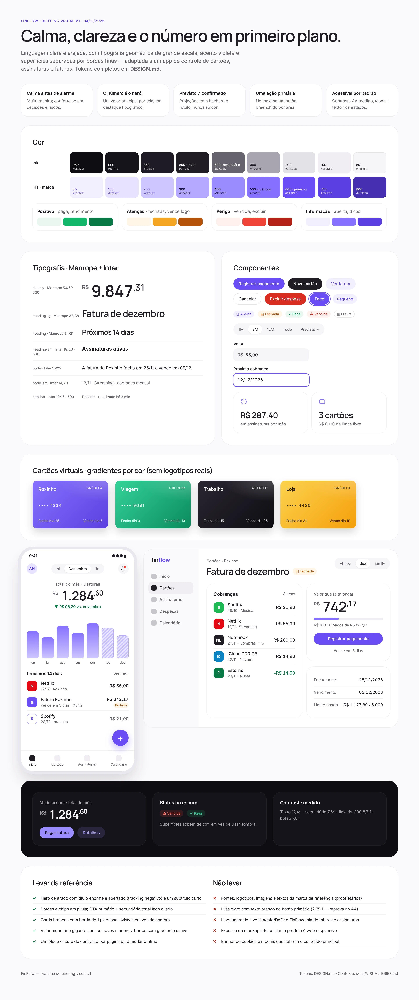

# FinFlow — Briefing visual

| Campo | Valor |
|---|---|
| Versão | 1.0 |
| Data | 2026-11-04 |
| Referência | Captura de [aave.com](https://aave.com) em `aave.com/` (commit `428df40`) |
| Sistema de design | [`DESIGN.md`](../DESIGN.md) (tokens, componentes, regras) |
| Prancha | [`docs/design/visual-brief-board.html`](design/visual-brief-board.html) · imagem abaixo |

---

## 1. Objetivo

Dar ao FinFlow uma identidade visual **calma, confiável e direta**, que transforme cartões, assinaturas e faturas — assuntos que geram ansiedade — em algo fácil de ler em segundos. A interface deve responder sempre a três perguntas: **quanto vou pagar, quando e onde**.

**Para quem:** as personas do [PRD §4](PRD.md#4-personas) — Ana (muitas assinaturas, quer cortar o que não usa), Carlos (vários cartões da família, foco em vencimentos) e Bia (separa pessoal × trabalho). Uso majoritário no celular, consultas rápidas; no desktop, revisão mensal mais detalhada.

## 2. Atributos de marca

| Somos | Não somos |
|---|---|
| Calmos — muito espaço, poucas cores, nada piscando | Alarmistas — vermelho por toda parte, banners de urgência |
| Claros — um número principal, rótulos em português simples | Técnicos — jargão bancário, tabelas densas sem hierarquia |
| Confiáveis — consistência, valores sempre exatos, previsto ≠ confirmado | "Fintech de cassino" — gradientes neon, gamificação, confete |
| Modernos — tipografia geométrica grande, formas arredondadas | Corporativos — azul-banco, bordas duras, ícones de clip-art |
| Próximos — tom de conversa, "você" | Frios — mensagens de sistema, CAIXA ALTA |

## 3. Análise da referência (aave.com)

A captura foi renderizada (desktop 1440 px e mobile 390 px) e os estilos computados foram medidos. O que caracteriza a linguagem:

| Aspecto | Observado na referência | Medição |
|---|---|---|
| Tipografia | Grotesca geométrica, títulos enormes e apertados, pesos intermediários (450/550) | H1 72/79 px, peso 550, tracking −3,6 px (−5%); H2 40/48 e 24/32; corpo 16–20 px |
| Cor de texto | Grafite levemente violáceo, hierarquia por **transparência** | `rgb(37,34,40)` a 90% (títulos) e 65% (subtítulos) |
| Acento | Lilás suave em CTAs, links, ícones e barras de gráfico | `#978EFF` (botão), `#8075FF` (links), fundo tonal 10% |
| Positivo | Verde vivo só para "ganhos" | ≈ `#01D062` |
| Forma | Pílulas em tudo que é clicável; cards muito arredondados | Botões `99px`; cards 24 px; painéis 32 px; inputs 36 px |
| Profundidade | Borda de 1 px quase invisível em vez de sombra | `0 0 0 1px rgba(37,34,40,.05)`; sombra só em elementos flutuantes |
| Ritmo | Seções centradas, largura de conteúdo ~980 px, muito respiro; um bloco **escuro** (`#0F0F10`, raio 32) para contraste | — |
| Dados | Saldo gigante com **centavos menores**; barras com gradiente lilás vertical; seletor de período em pílula (1W · 1M · 1Y · All · Future) | — |
| Padrões | Stat tiles (ícone + número + legenda), carrossel de depoimentos, FAQ em acordeão, newsletter em card | — |

### 3.1 O que levamos, adaptamos e descartamos

| Levamos | Adaptamos | Descartamos |
|---|---|---|
| Títulos grandes com tracking negativo | Fonte: **Manrope + Inter** (OFL) no lugar da fonte proprietária da referência | Fontes, logotipos, imagens e textos da marca (proprietários) |
| Pílulas e cards com borda hairline | Acento **Iris** próprio, mais profundo: `#6A4DF5` em botões (5,26:1) | Lilás claro com texto branco no CTA — **2,75:1, reprova no WCAG AA**; links a 3,56:1 também reprovam |
| Hierarquia por opacidade do texto | Texto secundário com contraste medido (`#67636D`, 5,86:1) | Verde vivo como texto (contraste insuficiente) — usamos `#087A45` |
| Valor com centavos menores | `MoneyDisplay` com formato pt-BR (`R$ 9.847,31`) e `tabular-nums` | Linguagem de investimento/DeFi ("APY", "yield") |
| Barras com gradiente + seletor de período | "Previsto" com **hachura + rótulo**, não só cor | Excesso de mockups de celular (o FinFlow é web responsivo) |
| Bloco escuro de contraste | Usado na landing e no modo escuro do app | Banners de cookies/avisos sobre o conteúdo principal |

> ⚠️ **Licenciamento:** a pasta `aave.com/` versionada contém fontes proprietárias (`AaveReproVariable.woff2`, `AaveAguzzo.woff2`), imagens e textos da marca. Como o repositório é **público**, recomenda-se removê-la do Git (mantendo uma cópia local, fora do repositório) — ela serve só como inspiração e nenhum arquivo dela é usado pelo FinFlow.

## 4. Direção visual

| Dimensão | Direção |
|---|---|
| **Cor** | Base branca e grafite (`ink`); violeta **Iris** como única cor de marca; semânticas (verde/âmbar/vermelho) reservadas a estados de fatura e alertas. Modo escuro completo desde o início. → [DESIGN §2](../DESIGN.md#2-cor) |
| **Tipografia** | Manrope para títulos e valores (pesos 600, tracking negativo); Inter para interface e tabelas (`tabular-nums`). → [DESIGN §3](../DESIGN.md#3-tipografia) |
| **Forma** | Pílulas para tudo clicável; cards 24 px; painéis 32 px; cartão virtual 16 px na proporção real (1,586:1). |
| **Profundidade** | Bordas hairline; sombras só para o que flutua (menus, diálogos, cartão virtual). |
| **Iconografia** | Lucide, traço 1,5 px, 20 px na interface e 24 px em stat tiles; nunca ícones preenchidos misturados. |
| **Imagens** | Sem fotos de banco de imagens. Mockups do próprio produto (telas reais) na landing; ilustrações de estado vazio em traço `iris-300`. |
| **Serviços e instituições** | Assinaturas mostram avatar com iniciais e cor neutra/categoria; logotipos de serviços só via catálogo licenciado (v1.1). Cartões mostram um **selo da instituição** com iniciais + cor de referência ou um **ícone enviado pelo próprio usuário** (privado); logotipos oficiais embutidos ficam para o futuro, com as condições do [DESIGN §11](../DESIGN.md#11-futuro-logotipos-oficiais-das-instituições). Bandeiras (Visa, Mastercard…) só como texto. |
| **Dados** | Gradiente `iris-500 → iris-200`; previsto com hachura; uma cor por cartão; categorias em paleta de 8 cores. |
| **Movimento** | Discreto (120–320 ms, `ease-out`); contagem de números só na primeira renderização; respeitar `prefers-reduced-motion`. |

## 5. Prancha

Fonte editável: [`design/visual-brief-board.html`](design/visual-brief-board.html) (abre no navegador; usa Manrope e Inter do Google Fonts). Todos os valores vêm do `DESIGN.md`.

## 6. Telas prioritárias

| # | Tela | Pergunta que responde | Elementos-chave | Critério de sucesso |
|---|---|---|---|---|
| 1 | **Dashboard** | "Quanto sai este mês e o que vem por aí?" | `MoneyDisplay` do total do mês + variação; cartões com fatura atual e barra de limite; projeção 12 meses; próximos 14 dias; categorias | Entender o mês em < 5 s, sem rolar no celular |
| 2 | **Fatura** | "Quanto devo, até quando, e por quê?" | Saldo em destaque + badge de status; datas; lista de cobranças (materializadas × previstas); pagamentos; "Registrar pagamento" | Conferir a fatura real item a item; pagar em 2 toques |
| 3 | **Assinaturas** | "Com o que estou gastando todo mês?" | Custo mensal/anual; filtros em chips; cards com valor, ciclo, próxima cobrança e cartão; status (teste, pausada) | Identificar a assinatura mais cara e cancelá-la em < 30 s |
| 4 | **Novo lançamento** (sheet) | "Como registro rápido?" | Abas Assinatura · Despesa · Cartão; `MoneyInput`; padrões inteligentes | Cadastrar uma assinatura em < 30 s (PRD O4) |
| 5 | **Cartões** | "Como estão meus cartões?" | `CardVisual`; fatura atual; limite; arquivar | Reconhecer cada cartão pela cor/apelido |
| 6 | **Calendário** | "O que acontece em cada dia?" | Visão de mês com marcadores; lista do dia | Ver vencimentos da semana de relance |
| 7 | **Onboarding** | "Como começo?" | 3 passos (cartão → assinaturas → lembretes), cada um pulável | Primeiro cartão + 3 assinaturas na 1ª sessão |
| 8 | **Landing** | "Por que usar o FinFlow?" | Hero centrado, mockup do produto, benefícios, privacidade ("nenhum dado real de cartão"), FAQ | Clareza da proposta; CTA "Começar grátis" |
| 9 | Notificações · Configurações · Login | — | Padrões de lista, formulário e estado vazio do `DESIGN.md` | Consistência |

## 7. Entregáveis e próximos passos

1. **Tokens no código:** `src/app/globals.css` com o bloco Tailwind v4 do [DESIGN §5](../DESIGN.md#5-tailwind-v4-srcappglobalscss); fontes via `next/font/google`.
2. **Componentes base** (shadcn/ui + tokens): Button, Input/MoneyInput, Card, Badge de status, Segmented, Sheet, Dialog, Toast, Bottom nav/Sidebar.
3. **Componentes de domínio:** `MoneyDisplay`, `CardVisual`, `ChargeRow`, `InvoiceStatusBadge`, `ProjectionChart`, `CategoryDonut`, `UpcomingList`.
4. **Telas 1–4** da tabela acima, consumindo os query services já prontos no backend.
5. **Revisão visual:** screenshots automatizados (Playwright) em 390 px e 1440 px, claro e escuro, comparados com a prancha.

## 8. Decisões em aberto

| Tema | Pergunta |
|---|---|
| Logo | Wordmark "finflow" em Manrope (como na prancha) ou símbolo próprio? |
| Tema padrão | Seguir o sistema (`prefers-color-scheme`) ou começar sempre claro? |
| Logos de serviços | Avatar com iniciais no MVP; catálogo com logos licenciados na v1.1? (instituições dos cartões: decidido — iniciais + ícone do usuário no MVP, logos oficiais no futuro) |
| Ilustrações | Traço simples em `iris-300` (proposto) ou outro estilo? |
| Landing | Mockups em celular, em navegador desktop ou ambos? |
